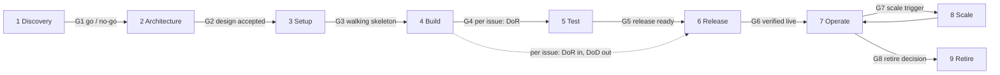

# New-project playbook research and kit design

Research note for AA-1099, S279, 2026-11-13. Author: Claude Code (research lane). Read-only: no code change, no
cloud call, no paid call. AA facts come from the repos (root `master`, each app's `origin/main`) and every one links
its source path. Every claim about an outside framework or tool carries its source URL in [Sources](#8-sources).
The full practice table is in the [inventory](inventory.md). The companion issue AA-1098 (the AA learning site) uses
this kit as one of its core courses.

The page ID sits under CAT-01 (the engineering handbook) because this is a research note for it. It does not take the
catalog slot GUIDE-08 ("Add a new app"), which stays planned; the kit's Setup page fills that slot later
([5.2](#52-docsplaybook-structure)).

**Decision page:** the design and the decisions in [section 7](#7-decisions-for-the-tech-lead) are also presented
on one artifact page for the tech lead. Link: *to be added when the orchestrator publishes it* (it is recorded in
[`docs/artifacts/registry.json`](../../artifacts/registry.json) at the same time).

## Summary

- **AA already has most of a new-project kit.** The [inventory](inventory.md) lists 161 practices: 101 are general and
  reusable as they are, 55 are general patterns wired to AA names and tools, and 5 are AA product and ops specifics
  that belong in the learning site, not the kit.
- **What is missing is the two ends of the lifecycle and the packaging.** There is no discovery phase, project
  charter, risk register, RACI or retirement checklist. There is no template repo, no "add a new app" how-to (GUIDE-08
  is still planned) and the agent skills are Vietnamese and hard-wired to AA paths.
- **Recommendation: build a thin "AA profile" over well-known standards, not a new method.** Nine lifecycle phases
  with a gate each, on the UK GDS phase model. Kanban flow with WIP limits. PRINCE2-style tolerances so agents act
  freely inside agreed limits and escalate only on a forecast breach. Gates are short checklists rated red, amber or
  green (an AA choice). DORA metrics and the DORA AI capabilities as
  the health check. arc42 canvas and C4 for architecture. OWASP ASVS level 1 as the release security gate.
- **Package it as four things:** `docs/playbook/` (one page per phase, written handbook-first so the learning site
  renders from the same source), the missing templates in `docs/templates/`, a Copier template repo that new
  projects generate from and later update from, and generic agent skills with an AA overlay.
- **Effort: about 9.5 sessions of work; about 5 sessions on the critical path** when the templates land first and
  the template repo, the generic skills and the playbook pages then run as parallel lanes
  ([section 6](#6-rollout-and-effort)).
- **Cost to build the kit: 0 USD** (open-source tools, GitHub Actions is free on public repos, no new cloud service).
  **Cost to run each new project is not zero:** a Dev skeleton costs about 10 to 35 USD a month on a shared platform
  and about 80 to 120 USD a month standalone ([costs](#costs)). It is quoted at gate G1.
- **Fourteen decisions for the tech lead** are in [section 7](#7-decisions-for-the-tech-lead), each with a proposed
  answer, and a [ready-to-file draft](#71-draft-build-issue) of the build issue follows them.

## 1. Why and goals

### 1.1 The problem

The tech lead asked (S279) for a standard kit of technical, process, governance and management documents. A new
project should apply it at once and run the full product lifecycle without reinventing the rules.

AA built these rules over about 280 sessions, mostly as reactions to real failures. They work, but they are:

- **Spread out.** The rules live in the [engineering handbook](../../engineering-handbook.md), the
  [data standards](../../architecture/data-standards/README.md), 32 ADRs (33 files with the index), 11 skills, 7 agent hooks, the
  [lesson log](../../../skill/aa-lessons/lessons.md) (447 lines) and four app `CONTEXT.md` files. The CIS
  `CONTEXT.md` alone is about 530 KB.
- **Wired to AA.** Skills and hooks name AA repos, services, accounts and people. A new project cannot copy them.
- **Partly private.** Some working rules live only in agent memory, not in the repo (see [3.3](#33-gaps)).
- **Open at both ends.** The handbook lifecycle ([§3](../../engineering-handbook.md#3-lifecycle-stages)) starts at
  "an idea becomes a Linear issue" and ends at "tell the business". Nothing covers deciding whether to start, or how
  to shut a product down.

### 1.2 Goals

Goals are numbered O1 to O6 so they do not clash with the gate names G1 to G8.

| # | Goal | Measured by |
|---|---|---|
| O1 | A new project runs a walking skeleton on Dev within its first two sessions | Day-1 checklist done: repo from template, CI green, `/health` returns the commit SHA on Dev |
| O2 | Every lifecycle phase from discovery to retirement has deliverables, a gate and an owner | Lifecycle map below, no phase without a template |
| O3 | One source of truth feeds the playbook, the AA docs and the learning site | Templates live once in `docs/templates/`; the kit copies them under a byte-copy guard |
| O4 | Projects keep getting kit improvements after day 1 | `copier update` works on a generated project |
| O5 | Agent-ready and vendor-neutral | `AGENTS.md` is the instruction source; hooks and skills have no AA names in the generic layer |
| O6 | Startup scale | Two environments, no paid tool, the handbook ["Do not do now"](../../engineering-handbook.md#93-do-not-do-now) list still holds |

### 1.3 Not goals

- ISO conformance, certification or buying standards.
- A new methodology. The kit names the standard it follows for each part.
- Moving the existing AA repos onto the template. AA is the reference application; it aligns by hand where useful.
- An MVP. This is the full design; the rollout is phased in [section 6](#6-rollout-and-effort).

## 2. Lifecycle map

### 2.1 Phases and gates

Nine phases, mapped to the UK GDS phases (discovery, alpha, beta, live, retirement) and to the handbook's 12
stages. Each phase ends at a gate. A gate is a short self-assessed checklist rated red, amber or green. The phase names
come from GDS; the red / amber / green rating is AA's own choice, not a GDS rule. Green passes. Amber passes with a
recorded follow-up. Red stops.



| # | Phase | GDS phase | Handbook stages | Gate | Accountable |
|---|---|---|---|---|---|
| 1 | Discovery | Discovery | before stage 1 (new) | G1 go / no-go | Business owner |
| 2 | Architecture | Alpha | 4 Design | G2 design accepted | Tech lead |
| 3 | Setup | Alpha | none today (ADR 0008 playbook) | G3 walking skeleton on Dev | Tech lead |
| 4 | Build | Beta | 1-3, 5 | G4 per issue: Definition of Ready (an entry gate; Build has no phase exit gate, each issue leaves through G5 and G6) | Tech lead |
| 5 | Test | Beta | 6 | G5 release ready | Tech lead |
| 6 | Release | Beta / live | 7-8, 12 | G6 Definition of Done, verified live | Tech lead |
| 7 | Operate | Live | 9-11 | periodic reviews | Tech lead |
| 8 | Scale | Live | 11 (capacity) | G7 a measured scale trigger fires, or first prod | Business owner |
| 9 | Retire | Retirement | none today (new) | G8 retirement complete, zero residual cost | Business owner |

Gates G1 to G3 and G5 to G8 close a phase. G4 is the one gate that runs per issue at the start of Build; it
replaces a Build exit gate. Phases 4 to 6 repeat for every issue. A project is in several phases at once once it is live: it builds new issues
while it operates the released ones.

### 2.2 Roles (RACI per phase)

One human is Accountable for each phase. This follows the common RACI rule of one Accountable per deliverable
(Atlassian RACI guide in [Sources](#8-sources)). "Agents may be Responsible, never Accountable" is AA's own rule, not
a framework fact: it formalises AA's rule that subagents never merge
([`skill/ai-nghiep/SKILL.md`](../../../skill/ai-nghiep/SKILL.md) §3).

| Phase | Business owner | Tech lead | Orchestrator agent | Subagents / second agent | CI | Vendors |
|---|---|---|---|---|---|---|
| 1 Discovery | A | R | R (research, drafts) | C (research lanes) | - | C |
| 2 Architecture | C | A | R (ADR drafts) | C (reviews) | - | C |
| 3 Setup | I | A | R | R (scaffold tasks) | R (first green run) | C |
| 4 Build | I | A | R (gatekeeper) | R (code) | R | - |
| 5 Test | C (UAT) | A | R | R | R | - |
| 6 Release | I (business update) | A | R (merge, deploy, verify in the dev phase) | - | R | - |
| 7 Operate | I | A | R | C | R (scheduled guards) | C |
| 8 Scale | A (scale decision and new spend) | R (design, prod blueprint) | R | C | - | C |
| 9 Retire | A | R | R | C | R | C |

A = accountable, R = responsible, C = consulted, I = informed. From the first prod release or first paying tenant,
the tech lead also approves risky merges (data standards DM-11.5,
[`02-data-management.md`](../../architecture/data-standards/02-data-management.md)). In Scale the business owner is
Accountable because the phase exists to approve new spend; the tech lead designs the change and owns its technical
quality through the Release gate of each change.

**Other team shapes.** The table assumes AA's shape: one tech lead, one business owner and several agents. A new
project may differ, so the template asks for the team shape ([5.4](#54-template-repo-copier)):

| Team shape | What changes |
|---|---|
| Tech lead plus agents (AA, default) | As above. Agents review agents for risky classes; code owners switch on at G7 |
| Several engineers plus agents | Each engineer can be R; the tech lead stays A. `CODEOWNERS` is enforced from day 1, and a risky-class PR needs one human approval in addition to CI, not only an agent review. The orchestrator role is held by one engineer per session |
| Engineers only, no agents | Agent files, hooks and skills are not generated. Tolerances become the team's working agreement. Human review on every PR; the session ritual becomes a short weekly review |


### 2.3 Phase by phase

Each phase lists its deliverables, the gate questions, the AA material that exists today and what is missing.
"New" marks a template the kit must add.

#### Phase 1: Discovery

Goal: understand the problem and decide whether to build at all. GDS: discovery restates the solution as a problem,
quantifies the cost of the problem and ends in go / no-go; stopping is not failure.

- **Deliverables:** discovery brief (new), project charter with goal, success metrics, appetite and tolerances
  (new), stakeholder map and RACI (new), first risk register (new), cost sheet v0 (new), buy-versus-build note
  (new), first data look and privacy screening (personal data classes, countries, residency, lawful basis).
- **Gate G1:** Is the problem backed by evidence? Is one success metric defined? Is the appetite set in sessions and
  USD? Does the ADR 0008 decision gate say new app, module of an existing app or API client? Is "stop" a real option?
  Privacy screening: does the product handle personal data? If yes, which data classes and countries, where the data
  will live (residency), the lawful basis for each purpose, and a short screening of whether the processing is high
  risk and needs a full data protection impact assessment. Is the monthly running cost of the Dev skeleton quoted
  ([costs](#costs))?
- **AA has:** the ADR 0008 decision gate
  ([`0008-new-app-integration-and-data-platform-rules.md`](../../adr/0008-new-app-integration-and-data-platform-rules.md)
  §2), research notes such as the [Odoo comparison](../2026-11-10-odoo-tour-travel-plugin-comparison.md), the
  business model ADR ([`0019-b2b-only-ecosystem-model.md`](../../adr/0019-b2b-only-ecosystem-model.md)).
- **Missing:** charter, discovery brief, stakeholder map, RACI, risk register, success metrics, buy-versus-build
  checklist.

#### Phase 2: Architecture

Goal: choose the boundaries that are hard to reverse, and write them down before code.

- **Deliverables:** `CONTEXT.md` on the arc42 canvas (new template), C4 context, container and deployment diagrams
  as code, first ADRs (stack, data ownership, identity, tenancy, environments), quality requirements under the nine
  ISO 25010 names, contract list, schema ownership row, light threat model (new), AI use register rows if the
  product uses AI.
- **Gate G2:** Every entity has one writer. Every cross-app read goes through a named contract. The security level
  is chosen per area (ASVS level 1, level 2 for auth, payment and personal data). Every personal-data entity has a
  row in the privacy register ([`docs/legal/register.md`](../../legal/register.md), inventory T76) with its retention;
  the impact assessment is done when the G1 screening said high risk. Costs are estimated. The environment model is
  chosen.
- **AA has:** [ecosystem architecture](../../ecosystem-architecture.md),
  [ADR index and placement rule](../../adr/README.md), [ADR template](../../templates/adr.md),
  [contracts](../../contracts/README.md), [data standards](../../architecture/data-standards/README.md),
  [schema ownership](../../database/schema-ownership.md), [AI use register](../../architecture/ai-use-register.md),
  [diagrams as code](../../architecture/diagrams/README.md),
  [environment model](../../adr/0012-environment-model.md).
- **Missing:** an arc42 / C4 template, a threat model, the HTTP API conventions ADR (0013 is reserved but unwritten:
  URL prefixes, versioning, error shape, pagination, idempotency).

#### Phase 3: Setup

Goal: a walking skeleton: an empty product that builds, deploys to Dev and is observed, with every guard on.

- **Deliverables:** repos generated from the template, CI green, pre-push hook, code-health and coverage ratchets,
  docs lint, secret scan, agent files and hooks, tracker project and plan, cloud accounts and roles through IaC,
  CI-to-cloud OIDC, tags and budgets, secrets register, identity client, database schema with roles and the first
  migration, job table, settings registry, logs, error tracking and `/health`.
- **Gate G3:** `/health` on Dev returns the commit SHA, deployed by CI. All checks green on an empty PR. A budget
  alert exists. The isolation probe passes if the product is multi-tenant.
- **AA has:** the ADR 0008 12-step playbook (§3: design, owner registration, roles, first migration, tenancy,
  contract reads, events, identity, platform services, personal data, ops, isolation probe),
  [onboarding](../../onboarding.md), the Infra layout (`infra/AA-CIS-Infra/CONTEXT.md`), the
  [tagging standard](../../architecture/tagging-standard.md), the [secrets register](../../security/secrets-register.md).
- **Missing:** the template repo, the "add a new app" how-to (GUIDE-08, planned in the [catalog](../../README.md)),
  local development setup per repo.

#### Phase 4: Build

Goal: small, ready issues turned into reviewed changes.

- **Deliverables:** issues that pass the Definition of Ready, PRs as change records, implementation notes,
  migrations through the expand / contract flow, contracts with samples, flag register rows, settings rows, lesson
  lines.
- **Gate G4 (per issue):** Definition of Ready before work starts; CI plus review by risk class before merge.
- **AA has:** [Definition of Ready](../../templates/definition-of-ready.md),
  [`aa-linear-issue`](../../../skill/aa-linear-issue/SKILL.md), [PR template](../../../.github/pull_request_template.md),
  [migration rules](../../architecture/data-standards/01-engineering.md),
  [parallel lanes](../../../skill/aa-session/references/parallel-lanes.md), [lesson log](../../../skill/aa-lessons/SKILL.md).
- **Missing:** a coding style guide beyond the linters (module layout, error handling, async patterns), an appetite
  field per issue.

#### Phase 5: Test

Goal: prove the change works before users see it.

- **Deliverables:** a test strategy page (what to test where), unit and integration tests, contract samples,
  Playwright smoke, visual and signed-in E2E, eval regression for AI changes, isolation probe for tenant changes,
  UAT report for business-visible features.
- **Gate G5:** every check green, not only the required ones. Risky classes reviewed by an independent agent. ASVS
  level 1 items of the touched area checked.
- **AA has:** CI workflows in each app (for example `apps/AA-CIS-App/.github/workflows/ui-smoke.yml`,
  `eval-regression.yml`), [UI verify skill](../../../skill/aa-ui-verify/SKILL.md),
  [UAT report template](../../templates/uat-report.md), [isolation probe](../../ops/runbooks/isolation-probe.md).
- **Missing:** the test strategy page, an accessibility standard, an ASVS checklist.

#### Phase 6: Release

Goal: changes reach Dev (later prod) and are proven live.

- **Deliverables:** release checklist, migrations applied in order, flags flipped, post-deploy verify, verified-live
  evidence comment, release note with verified work only, business update.
- **Gate G6:** Definition of Done = merged, CI green, rollout completed, live endpoint returns the right shape, UI
  checked, evidence posted.
- **AA has:** [`aa-ship`](../../../skill/aa-ship/SKILL.md), [release note template](../../templates/release-note.md),
  [feature flags](../../ops/feature-flags.md), [`aa-jira-update`](../../../skill/aa-jira-update/SKILL.md).
- **Missing:** the release checklist as one template (today it is inside `aa-ship`), per-app deploy pages and a
  CHANGELOG process (APP-01 and APP-07 are planned).

#### Phase 7: Operate

Goal: keep it running, learn from every failure, watch the cost.

- **Deliverables:** alarms linked to runbooks, incident records, postmortems, drills, backups, secret rotation,
  quarterly access review, monthly capacity and cost review, weekly delivery metrics, lessons turned into guards.
- **Gate:** none permanent; the periodic reviews are the control.
- **AA has:** [operations index](../../ops/README.md), [incident response](../../ops/incident-response.md),
  [postmortems](../../ops/postmortems/README.md), [drills](../../ops/drills/README.md),
  [FinOps](../../ops/finops.md), [access review](../../templates/access-review.md),
  [capacity review](../../templates/capacity-review.md).
- **Missing:** measured SLOs, a disaster-recovery overview, a delivery metrics report, tested versions of several
  runbooks (rollback, secret rotation, break-glass, schema restore are still UNTESTED).

#### Phase 8: Scale

Goal: grow only when a measured trigger says so, cheapest lever first.

- **Deliverables:** trigger table, capacity review, prod blueprint, prod-phase governance switch (risky merges need
  the tech lead, code owners enforced), SLO with an error budget policy, on-call.
- **Gate G7:** a scale trigger row fires, or the first prod release or paying tenant is dated.
- **AA has:** [scaling standard](../../architecture/data-standards/03-scaling.md) (C3, C9 trigger ladder),
  [lean account model](../../adr/0018-lean-aws-account-model.md), merge rights by phase (DM-11.5).
- **Missing:** a tested hand-over from dev-phase to prod-phase rules, the SLO and error budget template.

#### Phase 9: Retire

Goal: shut a product, app or feature down cleanly and stop paying for it.

- **Deliverables:** retirement ADR, notice to users and tenants, data export and erasure per retention, major
  contract sunset (served in parallel at least 30 days), tombstones or redirects, infrastructure destroy plan,
  secret deletion, a cost check that shows zero, docs archived, a final lesson entry.
- **Gate G8:** nothing left running or billed, verified on the cloud bill and the inventory.
- **AA has:** real cases but no general procedure: the account removal recorded in
  [ADR 0001a](../../adr/0001a-retire-acc1-llm-on-acc3-only.md), tour retirement in
  [ADR 0015](../../adr/0015-tour-liveness-and-retirement-propagation.md), the
  [dead table registry](../../architecture/dead-table-registry.md),
  [DRY RUN for destructive work](../../../skill/aa-cis-schema/references/destructive-ops.md).
- **Missing:** a generic retirement checklist.

### 2.4 Coverage check against ISO/IEC/IEEE 12207

The standard groups lifecycle processes in four groups. It is used here only as a "did we forget a whole area"
test, not for conformance.

| 12207 group | Where the kit covers it | Gap |
|---|---|---|
| Agreement (acquisition, supply) | Vendor handling in [`stakeholders-english.md`](../../../skill/ai-nghiep/references/stakeholders-english.md), [privacy register](../../legal/register.md) | No vendor selection or contract review checklist |
| Organizational project-enabling (lifecycle model, infrastructure, portfolio, human resources, quality, knowledge) | The playbook itself, the handbook, the learning site (AA-1098) for knowledge | No competency matrix; one product portfolio only |
| Technical management (planning, assessment and control, decisions, risk, configuration, information, measurement, quality assurance) | Backlog and plan, ADRs, git, docs catalog, CI | No risk register; no delivery metrics |
| Technical processes (needs, requirements, architecture, design, implementation, integration, verification, transition, validation, operation, maintenance, disposal) | Phases 1 to 9 | Disposal had no procedure: now phase 9 |

## 3. Practice inventory

### 3.1 Counts

The full table, with source path and "what the generic version must change" per row, is in the
[inventory](inventory.md).

| Part | Practices | General (G) | Pattern, needs parameters (P) | AA-specific (A) |
|---|---|---|---|---|
| Technical | 85 | 47 | 33 | 5 |
| Process | 34 | 23 | 11 | 0 |
| Governance | 24 | 21 | 3 | 0 |
| Management | 18 | 10 | 8 | 0 |
| **Total** | **161** | **101** | **55** | **5** |

The five AA-specific rows are AA product and ops specifics: two are product knowledge (the CIS content pipeline,
the Booking and Partner domains) and three are AA ops wiring (T33 LLM account routing, T45 the database migrate and
exec runbooks, T78 the admin spend page). They go to the learning site.

**Scope placement.** AA-1099 groups "DRY RUN" under process and "data standards" under governance. The inventory
files them under Technical (T43 for DRY RUN; T35, T36 and T38 for the data standards) because their sources are
technical documents. The counts above follow the inventory, so they do not map one-to-one onto the issue's grouping.
Read those four rows as also belonging to Process (T43) and Governance (T35, T36, T38); the
[inventory](inventory.md) carries the same note.

### 3.2 What a generic version must change

Most "P" rows need the same few changes:

1. **Names become parameters:** repo list, service names, issue key prefix, tracker, memory store, cloud accounts.
2. **Language:** generic skills in English; the AA overlay may stay Vietnamese
   ([language convention](../../../.kiro/steering/language-convention.md)).
3. **Options instead of one shape:** single repo or root plus app repos, multi-tenant or not, AI features or not.
4. **Agent files:** `AGENTS.md` as the source, `CLAUDE.md` importing it, instead of `.kiro/steering` plus
   `.claude/CLAUDE.md`.
5. **Split rule blocks:** the lane rules ([`lane.js`](../../../tools/workflows/lane.js) COMMON), the shell guard and
   the lessons each mix general and AA-only lines; split them into a generic block and an AA block.

### 3.3 Gaps

Ordered by how much they block the kit.

| # | Gap | Evidence | Fix in the kit |
|---|---|---|---|
| 1 | No discovery phase: no charter, brief, stakeholder map, success metrics | Handbook [§3](../../engineering-handbook.md#3-lifecycle-stages) starts at a Linear issue | Phase 1 templates |
| 2 | No risk register | Risks only in `milestones[].risks` of [`plan.json`](../../backlog/tracker/plan.json) | Risk register (RAID) template |
| 3 | No RACI | Roles spread over handbook §2.3, the voice guide and the approval matrix | RACI in [2.2](#22-roles-raci-per-phase) and a template |
| 4 | No retirement procedure | Only case records (ADR 0001a, ADR 0015) | Retirement checklist |
| 5 | No "add a new app" how-to | GUIDE-08 planned in the [catalog](../../README.md) | Phase 3 page plus the template repo |
| 6 | No template repo | Each repo hand-built | Copier template |
| 7 | Rules only in private agent memory: decide-don't-ask, no agent-made gates, paid-run subset, quote before any paid service, verify live before claiming, owner report as one page; the "every threshold is an admin-editable setting" rule exists for CIS (inventory T18, V20) but not yet as a rule for every app | Not in any merged ecosystem-wide repo file (the threshold rule is tracked in AA-1096) | Move into the handbook or skills before the kit build (decision D11) |
| 8 | Stale or conflicting rules across sources | Role guides "side by side" (`ai-nghiep`) vs `.vi.md` files (language convention); the PR-title guard coverage differs between `aa-linear-issue` and `aa-ship`; DM-11.1 says ADR 0009 is not written but it exists; [`finops.md`](../../ops/finops.md) still describes the LLM account layout from before S278; [`docs/audits/README.md`](../../audits/README.md) is not an index of all audits | One clean-up PR before the kit copies anything |
| 9 | ADR 0011 and ADR 0014 still Proposed although practised daily; the handbook decision D-14 ("root private") is stale since the root repo went public | [`0011`](../../adr/0011-github-app-identity-and-merge-rights.md), [`0014`](../../adr/0014-repo-visibility-and-github-plan.md), [handbook §9](../../engineering-handbook.md) D-14 | Tech lead accepts or amends; needed before the public template repo (D13) |
| 10 | No test strategy page | Tests spread over workflows and skills | Test strategy template |
| 11 | No threat model | Security knowledge spread over the baseline, SEC rules and `CONTEXT.md` | Light threat model template |
| 12 | HTTP API conventions ADR unwritten | ADR 0013 reserved | Write it as part of the kit (generic ADR) |
| 13 | No SLO or error budget template; no delivery metrics | Only rules in [03-scaling](../../architecture/data-standards/03-scaling.md) C1 | SLO template, DORA report |
| 14 | Many runbooks UNTESTED | [Operations index](../../ops/README.md) status column | Templates carry the tested rule; AA drills stay in AA backlog |
| 15 | Learnable order missing: `CONTEXT.md` of CIS about 530 KB, Partner about 380 KB | `git show origin/main:CONTEXT.md` sizes | Size cap in the `CONTEXT.md` template; module pages (also an LMS input) |
| 16 | No accessibility standard, no coding style guide, no local dev guide per repo | UI kit rules only in code | Three short templates |
| 17 | No vendor selection checklist; no competency matrix | Vendor tone guide only | Vendor checklist (18F base); competency matrix belongs to AA-1098 |

## 4. Benchmark against frameworks

Verdicts: **adopt** (take as is), **adapt** (take the idea in AA's lighter form), **skip** (overkill at this size).
Every skip below already appears in the handbook ["Do not do now"](../../engineering-handbook.md#93-do-not-do-now)
list or is consistent with it.

| Framework | What it offers | Verdict | What the kit takes | What it skips |
|---|---|---|---|---|
| ISO/IEC/IEEE 12207:2017 | Lifecycle processes in four groups; tailoring annex; no fixed model | Adapt | The four groups as a coverage check ([2.4](#24-coverage-check-against-isoiecieee-12207)) | Conformance, per-process work products, buying the standard |
| ISO/IEC 25010:2023 | Nine product quality characteristics (adds safety; renames usability and portability) | Adopt | The nine names as headings for quality requirements and the release checklist | The full measurement programme |
| PMBOK Guide, 7th edition (2021) | Twelve principles and eight performance domains: stakeholders, team, development approach and life cycle, planning, project work, delivery, measurement, uncertainty | Adapt | Four domains as a checklist for the management templates: stakeholders (stakeholder map), planning (charter, cost sheet), measurement (metrics), uncertainty (risk register) | Plans per knowledge area, earned value |
| PRINCE2 7 | Manage by stages, manage by exception with tolerances (time, cost, scope, quality, risk, benefits) | Adapt | Stage gates; tolerances as the agent autonomy rule; learn from experience = lesson log | Project board, full product descriptions, certification |
| Scrum Guide 2020 | Product Goal, Definition of Done, review and retrospective | Adapt | Product Goal in the charter; DoD; session close as the retro | Sprints, daily stand-up, Scrum Master |
| Kanban Guide | Visualise, limit WIP, manage flow; WIP, throughput, work item age, cycle time | Adopt | WIP limit (already 8 In Progress), the four flow metrics, a service level expectation later | Monte Carlo forecasting before there is history |
| Shape Up | Appetite instead of estimates, shaping before building, circuit breaker; appendix says small teams skip the cycles | Adapt | Appetite per issue, circuit breaker on paid runs and stuck issues | Six-week cycles, betting table |
| DORA metrics | Five delivery metrics: lead time, deploy frequency, recovery time, change fail rate, rework rate | Adopt | Computed weekly by a cheap script from git, deploy and incident records | Dashboards or paid tools before prod traffic |
| DORA capabilities and AI model | Capability catalogue; seven AI capabilities | Adopt | The seven AI capabilities as the agent readiness check ([5.8](#58-measurement)) | Full capability assessment |
| Google SRE | SLOs set by the business, error budget policy, blameless postmortems with triggers | Adapt | One SLO per user-facing service, one-page error budget policy, postmortem triggers; switched on at first prod | Burn-rate alerting and on-call on Dev |
| C4 model | Context, container, component, code; context and container are enough for most teams | Adopt | Context, container and deployment views as code | Hand-drawn component and code diagrams |
| arc42 | Free 12-section architecture template with a one-page canvas | Adapt | The canvas as the `CONTEXT.md` skeleton; section 9 links ADRs, 10 uses ISO 25010, 11 is the risk register | Filling all 12 sections on day 1 ("full arc42" is in "Do not do now") |
| MADR and Thoughtworks Radar on ADRs | Minimal ADR templates (CC0). Radar: "Lightweight Architecture Decision Records" was in Adopt and last appeared in May 2018; it is no longer on the radar. The warning that stale or bulk docs mislead agents comes from the "AI-driven documentation sprawl" Caution blip on the current techniques page | Adopt | MADR-minimal shape; a prune / supersede step | A separate decision tool |
| Thoughtworks Radar, agent techniques | Progressive context disclosure, agent sandboxing, feedback flywheel; "curated shared instructions" appears as a related blip, not a main entry; cautions on instruction bloat and AI-driven documentation sprawl | Adopt | Lean root instruction file, skills on demand, hooks as sandboxing, lesson log as the flywheel, AA-CIS as the reference application | Spec-driven tooling (still "assess") |
| AGENTS.md | Open Markdown format for agent instructions, under the Linux Foundation | Adopt | `AGENTS.md` as the source, `CLAUDE.md` imports it | Vendor-specific files as the source |
| Twelve-Factor App | Twelve app design rules; community-maintained since 2024; factor III stores config in the environment | Adopt, with one stated limit | App design checklist in Setup. Factor III applies to deploy config only: endpoints, secret references, per-environment switches. Policy values (thresholds, limits, caps) follow AA's rule (AA-1096, inventory T18, V20) and live in an admin-editable settings registry, not in environment variables. The two rules do not conflict once config is split this way, and the kit states the split | None |
| Trunk-based development | Short-lived branches, CI on trunk, merge queues at scale | Adopt | AA's flow as is | None |
| OWASP SAMM v2 | Five functions, 15 practices, three levels; pick a target by risk | Adapt | One light self-assessment per project, mostly level 1 | Annual full assessments, level 3 ("full SAMM" is in "Do not do now") |
| OWASP ASVS 5.0 | Verification requirements in three levels; "most applications will aim for Level 2" (OWASP developer guide) | Adopt | Level 1 as the release gate; level 2 for auth, payment and personal data areas | Level 3 by default |
| FinOps Framework | Inform, optimise, operate; crawl / walk / run per capability; token costs | Adapt | Cost sheet, tags from day 1, monthly review, token ledger per stage; stay at crawl / walk | Run maturity everywhere |
| ITIL 4 | Change enablement, incident management | Adapt | "Standard change" = a green PR under the merge rights rule; a light incident record | CAB, CMDB, ITSM tools |
| RACI | One Accountable per deliverable. "Agents are never Accountable" is AA's own rule added on top, not part of RACI | Adopt | RACI per phase ([2.2](#22-roles-raci-per-phase)) | A RACI per task |
| UK GDS Service Manual and Standard | Discovery, alpha, beta, live, retirement; 14-point standard; discovery reframes the solution as a problem, quantifies its cost, and stopping is not failure | Adapt | Phase names and gate questions on a trimmed set of the standard; the red / amber / green rating is AA's own choice | External assessment panels |
| 18F guides (archived, public domain) | De-risking guide: buy versus build, budgeting, vendor management | Adapt | Buy-versus-build and vendor checklists | None (frozen reference) |
| GitLab handbook-first | The handbook is the single source; change it first, then announce | Adopt | Playbook pages are the source; the learning site renders from them | A GitLab-sized handbook |
| Copier, cookiecutter with cruft, Backstage | Copier records answers and has `copier update` and per-version migrations built in; cookiecutter generates once, and cruft adds `cruft link` and `cruft update` so cookiecutter projects stay in sync with their template; Backstage needs a portal | Adopt Copier | Copier template repo, also marked as a GitHub template | cruft (a second tool for what Copier does alone); Backstage (in "Do not do now") |

Caveats from the research lane: the PMBOK row uses the 7th edition only, as in the cited PMI graphic; the 8th
edition renames some domains and is not used here. The PRINCE2 7 tolerance areas come from a secondary source. The
ITIL change-type definitions could not be read in full. The PMI blog page on RACI (HTTP 403) could not be read, so no
claim rests on it. Re-check these before the kit quotes them as rules.

## 5. Kit design

### 5.1 Principles

1. **Profile over standards.** Each kit page names the standard it follows and says what AA kept or dropped.
2. **One home per fact.** Templates live once in [`docs/templates/`](../../templates/); phase pages link them; the
   template repo copies them under a byte-copy guard, like the UI kit ([ADR 0016](../../adr/0016-one-design-system-guarded-kit-copies.md)).
3. **Handbook-first.** A rule changes in the kit page first, then in skills and copies. The learning site (AA-1098)
   renders from the same pages.
4. **Generic core plus overlay.** The kit has no AA names. AA keeps an overlay (accounts, services, people, Notion,
   Jira) that points at the generic pages.
5. **Tolerances, not approvals.** Agents act inside agreed limits and escalate only on a forecast breach (PRINCE2).
6. **Switches by phase.** Prod-only controls (error budget, on-call, enforced code owners, least-privilege agent
   role) are written now and switched on at G7, not before.
7. **Prune.** Every page has an owner and a review window; superseded rules are deleted, not kept beside the new one.

### 5.2 `docs/playbook/` structure

```text
docs/playbook/
  README.md                    index: lifecycle map, gates, RACI, how to start (+ .vi.md)
  principles.md                the seven principles and the tolerance table
  01-discovery.md              one page per phase: goal, deliverables, gate checklist (RAG),
  02-architecture.md           templates to use, AA reference examples, common mistakes
  03-setup.md                  (fills the planned catalog slot GUIDE-08 "Add a new app")
  04-build.md
  05-test.md
  06-release.md
  07-operate.md
  08-scale.md
  09-retire.md
  agents.md                    agent orchestration: roles, lanes, guardrails, session ritual, skills
  adoption.md                  day-1 checklist and 30/60/90-day plan
  metrics.md                   DORA and flow metrics, AI readiness check
  aa-profile.md                how AA maps onto the kit: overlay pointers, AA-only rules
```

Every page has a `.vi.md` sibling. The catalog ([`docs/README.md`](../../README.md)) gets one new entry for the
playbook after approval.

### 5.3 Templates

All templates go to [`docs/templates/`](../../templates/). "Exists" means the kit adapts the AA file; "new" means
the kit writes it.

| Template | Phase | Status | Built from |
|---|---|---|---|
| Discovery brief | 1 | New | GDS discovery; 18F buy versus build |
| Project charter (goal, success metric, appetite, tolerances, out of scope) | 1 | New | PMBOK domains; PRINCE2 tolerances; Scrum Product Goal |
| Stakeholder map and RACI | 1 | New | RACI rule; handbook [§2.3](../../engineering-handbook.md#23-roles) |
| Risk register (RAID: risks, assumptions, issues, dependencies) | 1, then all | New | arc42 section 11; `plan.json` risks |
| Cost sheet (unit cost, monthly forecast, paid items with their yes) | 1, then 7 | New | [FinOps](../../ops/finops.md); [cost report](../../templates/cost-report.md) |
| Vendor selection checklist | 1, 2 | New | 18F de-risking guide |
| `CONTEXT.md` on the arc42 canvas with C4 views | 2 | New template, pattern exists | arc42; C4; app `CONTEXT.md` files |
| ADR | 2, then all | Exists: [`adr.md`](../../templates/adr.md) | Add the MADR-minimal variant and a prune step |
| Light threat model (STRIDE per container) | 2 | New | Gap 11 |
| HTTP API conventions (generic ADR) | 2 | New | Gap 12 |
| Contract (JSON Schema, valid and invalid samples, registry row) | 2, 4 | Exists as rules: [contracts](../../contracts/README.md) | Folder template |
| Migration file (expand / contract header, self-registration) | 3, 4 | Exists as rules: MIG-1..14 | File template |
| Settings registry entry with operator guide | 3, 4 | Exists in CIS code | Row and guide template |
| Definition of Ready | 4 | Exists: [`definition-of-ready.md`](../../templates/definition-of-ready.md) | Add an appetite field |
| Implementation note | 4 | Exists: [`docs/implementation-notes/`](../../implementation-notes/) | As is |
| Test strategy | 5 | New | Gap 10 |
| Security checklist (ASVS 5.0 level 1, SAMM light) | 5, 6 | Exists in part: [security baseline](../../security/baseline.md) | Re-map to ASVS |
| UAT report | 5 | Exists: [`uat-report.md`](../../templates/uat-report.md) | As is |
| Release checklist (DoD, ISO 25010 axes, AI items, flags, migrations) | 6 | Exists inside [`aa-ship`](../../../skill/aa-ship/SKILL.md) | Extract into one page |
| Release note | 6 | Exists: [`release-note.md`](../../templates/release-note.md) | As is |
| Runbook | 7 | Exists: [`runbook.md`](../../templates/runbook.md) | As is, with the tested rule |
| Incident record | 7 | New, light | [Incident response](../../ops/incident-response.md); ITIL |
| Postmortem | 7 | Exists: [`postmortem.md`](../../templates/postmortem.md) | Add the SRE trigger list |
| Lesson log | 4, 7 | Exists: [`aa-lessons`](../../../skill/aa-lessons/SKILL.md) | Empty log plus the Guard checker |
| Capacity review, access review | 7 | Exist: [`capacity-review.md`](../../templates/capacity-review.md), [`access-review.md`](../../templates/access-review.md) | As is |
| Delivery metrics report (DORA and flow) | 7 | New | DORA |
| SLO and error budget policy | 8 | New, switched on at first prod | Google SRE workbook |
| Retirement checklist | 9 | New | Gap 4; ADR 0015 pattern |
| Session checklist and session log | all | Exists in [`aa-session`](../../../skill/aa-session/SKILL.md) | Generic template |

### 5.4 Template repo (Copier)

A new public repo in the GitHub organisation, generated with Copier and also marked as a GitHub template. It holds
no AA names, IDs or secrets (public-repo rule, [ADR 0014](../../adr/0014-repo-visibility-and-github-plan.md)).

```text
project-template/
  copier.yml                 questions and version
  template/
    AGENTS.md                agent instructions, lean, links to docs (source)
    CLAUDE.md                imports AGENTS.md
    CONTEXT.md               arc42 canvas
    .githooks/pre-push       fast local checks
    .github/
      workflows/             ci, pr-title, secret-scan (+ history), docs-lint, workflow-lint,
                             release-please, post-deploy-verify, api-contract, ui-smoke*, eval-regression*
      scripts/               code_health, coverage_ratchet
      code-health.json       limits: complexity 10, file 800 lines, empty baseline
      pull_request_template.md
    .claude/
      settings.json          hook registration
      hooks/                 subagent and MCP guardrails, generic shell guard rules, stop-open-work, PII guard
      skills/                generic skills (5.5)
    docs/                    catalog README, STYLE, templates, adr/, playbook links, contracts/,
                             backlog/, sessions/, implementation-notes/, lessons.md
    api/*                    FastAPI skeleton: /health, /health/ready, settings registry, job table and worker,
                             deploy-gate endpoint
    web/*                    Next.js BFF skeleton: security headers, cross-site write guard, UI kit
    db/migrations/*          <prefix>-001: schema, roles, schema_versions
    infra/*                  Terraform root: OIDC role, tags, budgets, state backend
    tools/uat/*              UAT harness
```

`*` = generated only when the matching Copier answer is yes.

| Copier question | Values | Default |
|---|---|---|
| Project name and slug | text | none |
| Repo layout | single repo, or root repo plus app repos | single repo |
| Stacks | Python API, Next.js web, Lambda | Python API and Next.js web |
| Multi-tenant | yes / no (yes adds RLS with FORCE, tenant pool, isolation probe, fair-share gate) | no |
| AI features | yes / no (yes adds the gateway core, ledger, prompt register, eval workflow, AI use register) | no |
| Cloud | AWS / none | AWS |
| Tracker | Linear / GitHub Issues / Jira | Linear |
| Issue key prefix | text | none |
| Languages | primary, secondary (secondary pages as `.<lang>.md`) | English, none |
| Team shape | tech lead plus agents / several engineers plus agents / engineers only (see [2.2](#22-roles-raci-per-phase)) | tech lead plus agents |

Updates: a generated project records its answers and the template version in `.copier-answers.yml` and runs
`copier update` to pull kit changes.

**Versioning and release policy**

| Item | Rule |
|---|---|
| Version scheme | Semantic version tags `vMAJOR.MINOR.PATCH` on the template repo. Copier generates and updates from git tags (Copier docs, "Updating a project") |
| Patch | Wording and link fixes in templates or docs; no file added, moved or removed |
| Minor | A new optional file, check or Copier question with a default that keeps today's output |
| Major (breaking) | A renamed or removed file or question, a new folder layout, or a new check that fails on a project that passed before. Ships a Copier migration task (`_migrations` in `copier.yml`) and an upgrade note |
| Release | release-please opens a release PR from Conventional Commit titles; merging it tags the version and writes `CHANGELOG.md`. The orchestrator cuts a release after each change to the root templates, because the byte-copy guard fails the template CI until the copy matches |
| Reaching projects | The monthly check in each project compares its recorded version with the latest tag and opens an issue when the project is one major or more than one minor behind. The project's orchestrator runs `copier update` on a branch, resolves conflicts like a merge, and ships it as a normal PR |
| Support | Only the latest major gets fixes. A major stays the latest for at least 30 days after its release note before the next major ships, so projects have time to update |

### 5.5 Generic skills

| AA skill | Generic skill | Parameters | Stays in the AA overlay |
|---|---|---|---|
| [`aa-session`](../../../skill/aa-session/SKILL.md) | `project-session` | live-check commands, memory store, tracker, plan file | Notion memory, cloud service checks, gateway status |
| [`aa-ship`](../../../skill/aa-ship/SKILL.md) | `project-ship` | repo list, merge tool, deploy commands, health URLs | merge-queue tools, DB Migrate flow |
| [`aa-lessons`](../../../skill/aa-lessons/SKILL.md) | `project-lessons` | lesson file path, areas | AA lesson content |
| [`aa-linear-issue`](../../../skill/aa-linear-issue/SKILL.md) | `project-issue` | tracker, projects, priority scale, quota rules | Linear Free export and archive |
| [`aa-jira-update`](../../../skill/aa-jira-update/SKILL.md) | `project-business-update` | channel, epics, language | Jira project keys, reader names |
| [`aa-ui-verify`](../../../skill/aa-ui-verify/SKILL.md) | `project-ui-verify` | apps, preview hosts, sign-in method | AA test logins |
| [`aa-wave-rerun`](../../../skill/aa-wave-rerun/SKILL.md) | `project-batch-run` | batch object, ladder, stop conditions, cost source | CIS pipeline stages |
| [`aa-uat-video`](../../../skill/aa-uat-video/SKILL.md) | `project-uat` | voices, languages | AA scripts |
| [`ai-nghiep`](../../../skill/ai-nghiep/SKILL.md) | `project-rules` (hard rules, ADR rules, handoff template) | none | accounts, people, voice guide |
| [`aa-cis-schema`](../../../skill/aa-cis-schema/SKILL.md), [`aa-ecosys-repos`](../../../skill/aa-ecosys-repos/SKILL.md) | none | none | stay AA |

Generic skills are written in English, at most about 150 lines each with references, following
[`skill/README.md`](../../../skill/README.md).

### 5.6 Agent orchestration package

`docs/playbook/agents.md` packages what AA learned about running a team of one human and several agents.

- **Roles.** Humans are Accountable; the orchestrator agent ships in the dev phase; subagents and the second coding
  agent code and commit locally only ([handbook §2.3](../../engineering-handbook.md#23-roles)).
- **Tolerances.** The agent acts without asking inside these limits and escalates only on a forecast breach, with
  one decision page that proposes an answer per question.

  | Tolerance | Limit (kit default) | AA source |
  |---|---|---|
  | Time | 3-5 issues per session; WIP at most 8 In Progress; appetite per issue | [`aa-session`](../../../skill/aa-session/SKILL.md) |
  | Cost | Monthly cost quoted and a yes for each new paid item; paid runs 3, then at most 50 | [FinOps](../../ops/finops.md), DM-10.6 |
  | Scope | Done-when frozen at In Progress; new scope becomes a new linked issue | [`aa-ship`](../../../skill/aa-ship/SKILL.md) |
  | Quality | Every check green; Definition of Done verified live | [`aa-ship`](../../../skill/aa-ship/SKILL.md) |
  | Risk | Risky classes need an independent agent review; destructive steps need the tech lead's yes after a DRY RUN | [destructive ops](../../../skill/aa-cis-schema/references/destructive-ops.md) |
  | Benefits | Business questions go to the business owner as options with a recommendation | [`aa-jira-update`](../../../skill/aa-jira-update/SKILL.md) |

- **Guardrails.** Hooks that block subagents from push, merge, apply and secret writes; MCP write blocks; shell guard
  rules learned from repeated mistakes; a stop hook while unblocked work remains; a personal-data guard. Each hook
  ships with its red-team tests ([`.claude/hooks/`](../../../.claude/hooks/)).
- **Session ritual.** Start: read state, check live, propose issues by plan slot. During: live checklist, lessons
  written at root-cause time. End: snapshot, lessons, drafts approved, then logs; repos back to clean main.
- **Lanes.** One worktree per lane, reviewers by lens (correctness, security and data), one fix pass, PR list with
  the live steps for the orchestrator ([`lane.js`](../../../tools/workflows/lane.js),
  [parallel lanes](../../../skill/aa-session/references/parallel-lanes.md)).
- **Instruction layering.** A lean `AGENTS.md` that links to docs loaded on demand (progressive disclosure), skills
  for procedures, lessons that become guards and are then deleted (feedback flywheel), a monthly prune.

### 5.7 Day-1 checklist and 30/60/90-day plan

The checklist is a tracked list of issues with an owner and a date, not prose.

**Day 1 (first two sessions)**

1. Business owner and tech lead fill the discovery brief and charter; G1 decided. Owner: business owner.
2. Generate the repo(s) with Copier; push; turn on branch protection and the merge queue. Owner: tech lead.
3. Create the tracker project, the plan file and the first backlog. Owner: orchestrator agent.
4. Fill `CONTEXT.md` on the arc42 canvas and the C4 context view. Owner: orchestrator agent, tech lead accepts.
5. Write the first ADRs: stack, data ownership, identity, environments. Owner: orchestrator agent, tech lead accepts.
6. Quote the Dev skeleton's monthly cost ([costs](#costs)) and get the business owner's yes; then create the cloud
   account and CI role through IaC, and set tags and a budget alert at that figure. Owner: tech lead.
7. Apply migration `<prefix>-001` (schema, roles) from CI. Owner: orchestrator agent.
8. Deploy the skeleton to Dev; `/health` returns the SHA. Owner: orchestrator agent.
9. Fill the risk register, cost sheet and secrets register (names only). Owner: orchestrator agent.
10. Run the first session close: snapshot, log, lessons file created. Owner: orchestrator agent.

**30 / 60 / 90 days**

| By day | Outcome | Checked by |
|---|---|---|
| 30 | First feature through DoR and DoD; ratchets and docs lint green; first lesson turned into a guard | Verified-live comment; CI history |
| 60 | Test strategy in use; ASVS level 1 checklist done for the touched areas; first runbook tested in a drill; DORA baseline taken | Drill evidence; first metrics report |
| 90 | First monthly cost and capacity review; first retro on the playbook itself; prune pass on instructions and ADRs; G7 plan written (what switches on at first prod) | Review files in `docs/audits/`; playbook issues raised |

### 5.8 Measurement

- **Delivery:** the five DORA metrics (change lead time, deployment frequency, failed deployment recovery time,
  change fail rate, deployment rework rate), computed weekly from git, deploy runs and incident records.
- **Flow:** WIP, throughput, work item age and cycle time from the tracker.
- **AI readiness:** the seven DORA AI capabilities, scored once per project and at each 90-day review.

| DORA AI capability | AA today | Kit default |
|---|---|---|
| Clear and communicated AI stance | Agent instruction files and hard rules | `AGENTS.md` plus `project-rules` |
| Healthy data ecosystems | Data standards, contracts | Data standards core |
| AI-accessible internal data | Generated schema reference, docs catalog, `llms.txt` | Dump workflow and catalog in the template |
| Strong version control | Trunk-based flow, merge queue | Same |
| Working in small batches | One deliverable per issue, 3-5 issues per session | Same |
| User-centric focus | Business updates, UAT | Charter success metric, UAT template |
| Quality internal platform | Skills, hooks, ship tools | Template repo and generic skills |

### 5.9 Acceptance measures for the kit

The kit is accepted when the pilot (R5) and the first real project meet these measures. The pilot measures the
first five rows; the first real project measures the rest.

| Measure | Target | Checked in |
|---|---|---|
| Generate to green: time from `copier copy` to all checks green on an empty PR | at most 1 session | R5 pilot log |
| Day-1 items that needed a manual fix not described in the playbook | 0 blocking, at most 3 minor; each one fixed in the kit before R5 closes | R5 pilot log |
| `copier update` from the previous tag to the latest on an untouched project | applies without conflict | R5, then every major release |
| Leak scans on the template repo (resource-ID lint, gitleaks) | 0 findings | Template repo CI |
| A fresh agent with no AA context runs the day-1 checklist from the docs alone | done without a question that the docs should have answered | R5 |
| Generate to live: time from `copier copy` to `/health` returning the commit SHA on Dev | at most 2 sessions (goal O1) | First real project (or the R5 deploy option, D14) |
| Retirement: the pilot or a test service removed with the phase 9 checklist | 0 resources and 0 USD left after one billing day | R5 deploy option (D14) |
| Adoption over time: DORA baseline by day 60, playbook retro by day 90 | both done | First real project's 30/60/90 plan |

## 6. Rollout and effort

A session here is one working session of the orchestrator agent with its lanes. Estimates assume the lane model
used in S279.

| Step | Work | Effort | Depends on |
|---|---|---|---|
| R0 | Tech lead approves this design and the decisions in section 7 | this issue | none |
| R1 | Clean-up: move private-memory rules into the handbook or skills; fix the stale rules in gap 8; settle ADR 0011 and 0014 status | 1 session | R0 |
| R2a | The new templates in `docs/templates/` and `principles.md` (with the tolerance table), English and Vietnamese | 1 session | R1 |
| R2b | The other `docs/playbook/` pages (index, nine phases, agents, adoption, metrics, AA profile), English and Vietnamese | 2 sessions | R2a |
| R3 | Copier template repo: skeletons, CI, hooks, docs lint, byte-copy guard from root templates, release-please and the versioning policy | 2 sessions | R2a |
| R4 | Generic skills and the AA overlay split; hook rule split | 2 sessions | R2a |
| R5 | Pilot: generate a throwaway sample project, run the day-1 checklist end to end, measure [5.9](#59-acceptance-measures-for-the-kit), fix what breaks, then delete it | 1 session | R3, R4 |
| R6 | Hook-up with the learning site (AA-1098): the playbook as a course, the inventory as the syllabus input | 0.5 session | R2b |

Total: about 9.5 sessions of work. R2 is split so the templates land first: R2b, R3 and R4 then start together as
parallel lanes. The critical path is R1 (1) → R2a (1) → R3 (2) → R5 (1), about **5 sessions** of calendar time.
Without the split, R3 and R4 would wait for all of R2 and the critical path would be about 7 sessions
(R1 1 + R2 3 + R3 2 + R5 1).

### Costs

| Item | Cost | Source |
|---|---|---|
| Copier, MADR, arc42, C4, OWASP ASVS and SAMM, DORA Quick Check | 0 USD, open or free | links in [Sources](#8-sources) |
| GitHub Actions on the public template repo | 0 USD for standard runners on public repos | GitHub billing docs |
| Cloud | 0 USD: the pilot generates and checks the project but does not deploy it. With the D14 deploy option: a few days on the shared Dev platform, estimated under 5 USD, quoted first | [FinOps rule](../../ops/finops.md) |
| LLM or paid API | 0 USD: no paid call in the kit build | none |
| Agent time | within the existing subscriptions | none |

**Running cost of each new project (decision input at G1)**

Building the kit is free; running what it generates is not. Steps 6 to 8 of the day-1 checklist deploy a skeleton
with a database, a job table and `/health` to Dev, and that bills every month. The kit's own rule (quote the monthly
cost and get a yes before any paid item) applies, so the charter carries this estimate. The figures are rough, from
AWS list prices; the G1 quote uses the AWS Pricing Calculator for the real region.

| Shape | What runs on Dev | Rough monthly cost | Source |
|---|---|---|---|
| Shared platform (AA's pattern: the new app joins an existing container cluster, database instance, private link and API gateway; own schema and roles) | Two small containers (api, worker), logs, a few secrets | about 10 to 35 USD. AA's per-app Dev budget caps (caps, not bills) are the reference: TripPlanner 10, Booking 25, CRM 35 USD a month | [`docs/ops/finops.md`](../../ops/finops.md) budgets table |
| Standalone (own account, own database and load balancer) | Two small Fargate tasks (about 15 to 20), the smallest PostgreSQL instance in one zone with 20 GB (about 15 to 20), an application load balancer (about 20), a NAT gateway (about 35, or less with public subnets), public IPv4 addresses, logs, secrets and image registry (about 10) | about 80 to 120 USD; the load balancer and NAT gateway are about half | AWS pricing pages for Fargate, RDS, Elastic Load Balancing, VPC, CloudWatch and Secrets Manager ([Sources](#8-sources)) |

The playbook recommends the shared shape on Dev whenever the project lives in the same organisation, as AA does
today; the standalone shape is for a project that must be isolated (another owner, another legal entity).

### Risks

| Risk | Mitigation |
|---|---|
| The kit drifts from AA practice | Templates have one home; the template repo copies them under a byte-copy guard; `copier update` |
| Instruction bloat misleads agents (Radar caution) | Lean `AGENTS.md`, skills on demand, prune pass at each 90-day review |
| AA names or IDs leak into the public template | Resource-ID lint in `--mode error` and gitleaks on the template repo |
| Over-documentation slows a small project | Gates are short RAG lists; arc42 canvas only; prod-only controls stay off until G7 |
| Conflicting rules copied into the kit | R1 clean-up runs before any copy |

## 7. Decisions for the tech lead

| # | Decision | Proposed answer | Why |
|---|---|---|---|
| D1 | Shape of the kit | A thin AA profile over named standards, not a new method | Most rules exist; standards give names, the profile keeps AA's lean choices |
| D2 | Lifecycle spine | The nine phases in [2.1](#21-phases-and-gates), mapped to GDS, with red / amber / green gate checklists (an AA choice) | GDS is the best public model with discovery and retirement |
| D3 | Delivery cadence | Kanban with the WIP cap of 8, the four flow metrics and an appetite per issue; no sprints | Fits session-sized agent work; matches the existing convergence rule |
| D4 | Agent autonomy | PRINCE2-style tolerances (table in [5.6](#56-agent-orchestration-package)); escalate only on a forecast breach | Writes "decide, don't ask" down as a rule that can be taught and checked |
| D5 | Where the kit lives | Pages in `docs/playbook/`, templates in `docs/templates/`, scaffold in a new public template repo in the organisation | One home per fact; the template must be shareable |
| D6 | Scaffold tool | Copier, with the repo also marked as a GitHub template | Copier has updates and per-version migrations built in: one tool, no wrapper (cookiecutter needs cruft for the same update path) and no portal; its questions are Jinja templates with conditions, which the optional modules need |
| D7 | Agent instruction source | `AGENTS.md` in the kit, `CLAUDE.md` imports it; AA keeps `.kiro/steering` for now | Vendor-neutral, open format |
| D8 | Skill language | Generic skills in English; the AA overlay may stay Vietnamese | Matches the language convention for products |
| D9 | Security gate | ASVS 5.0 level 1 at every release; level 2 for auth, payment and personal data; one light SAMM self-check per project | Checkable, free, not "full SAMM" |
| D10 | Prod-phase switch | SLO and error budget, on-call, enforced code owners and the least-privilege agent role switch on at G7 (first prod or first paying tenant), the same trigger as DM-11.5 | Keeps Dev lean; one trigger for all prod controls |
| D11 | Private rules | Move the memory-only rules (gap 7) into the handbook or skills in R1, before the kit copies anything | A rule that is not in the repo cannot be taught or reused |
| D12 | AA adoption | AA is the reference application; new repos start from the template; existing AA repos align by hand when touched | Avoids a big-bang migration of live repos |
| D13 | Template repo name and visibility | Name `project-template`, public in the GitHub organisation. It depends on ADR 0014 being accepted or amended in R1 to cover a public template repo, and on the stale handbook decision D-14 being updated | A public repo must rest on an accepted visibility rule; today ADR 0014 is Proposed and D-14 still says "root private" |
| D14 | Pilot deploy | R5 generates and checks the pilot without deploying it (0 USD). Option: deploy it to the shared Dev platform for a few days (under 5 USD, quoted first) and remove it with the phase 9 checklist | The option measures "generate to live" and tests the retirement checklist on a real service; the default keeps the build free |

After approval, the next step is to file the build issue below, placed in the next free slots of the
[master plan](../../backlog/tracker/README.md).

### 7.1 Draft build issue

Ready to file in Linear after the tech lead's yes, in the same project as AA-1099. If it is too big for one
deliverable slice under the Linear quota rule, split it into "R1 to R2b" and "R3 to R6" with the same Done-when lines.

**Title:** Build the new-project kit: playbook pages, templates, Copier template repo, generic skills

**Problem:** AA's lifecycle rules are spread over many files, wired to AA names and open at both ends. A new project
cannot apply them on day 1. AA-1099 designed the kit; this issue builds it.

**Scope:**

- R1 clean-up: move the private-memory rules (gap 7) into the handbook or skills; fix the stale rules (gap 8);
  accept or amend ADR 0011 and ADR 0014; update handbook D-14.
- R2a and R2b: the new templates in `docs/templates/` and the `docs/playbook/` pages ([5.2](#52-docsplaybook-structure),
  [5.3](#53-templates)), English with `.vi.md` siblings; one catalog entry.
- R3: the public Copier template repo ([5.4](#54-template-repo-copier)) with the versioning policy, release-please,
  byte-copy guard and leak scans; first tag `v1.0.0`.
- R4: the generic skills and the AA overlay ([5.5](#55-generic-skills)); hook rules split into generic and AA blocks.
- R5: the pilot, measured against [5.9](#59-acceptance-measures-for-the-kit); deploy only if D14 says so.
- R6: the playbook registered as a course for the learning site (AA-1098).
- Out of scope: moving the existing AA repos onto the template (D12).

**Done when:**

- The playbook pages, templates and catalog entry are merged on `master`, with docs lint green.
- The template repo is public, tagged `v1.0.0`, has a `CHANGELOG.md`, and its CI (byte-copy guard, resource-ID
  lint, gitleaks) is green.
- The generic skills and the AA overlay are merged, and the AA hook tests still pass.
- The R5 pilot log shows every pilot row of [5.9](#59-acceptance-measures-for-the-kit) met, and the pilot is removed.
- The learning site lists the playbook course (AA-1098).
- Lessons from the build are in the lesson log.

## 8. Sources

### Outside frameworks and tools

| Topic | Source |
|---|---|
| ISO/IEC/IEEE 12207:2017 preview | <https://www.vde-verlag.de/iec-normen/preview-pdf/info_isoiecieee12207{ed1.0}en.pdf> |
| ISO/IEC 25010:2023 | <https://www.sonarsource.com/resources/library/iso-iec-25010-explained/>, <https://www.iso.org/standard/78176.html> |
| PMBOK Guide, 7th edition: performance domains graphic (August 2021) | <https://www.pmi.org/standards/pmbok>, <https://www.pmi.org/-/media/pmi/documents/public/pdf/pmbok-standards/pmi-project-performance-domains.pdf> |
| PRINCE2 7 (secondary) | <https://www.prince2.com/uk/blog/the-7-principles-themes-and-processes-of-prince2> |
| Scrum Guide 2020 | <https://scrumguides.org/docs/scrumguide/v2020/2020-Scrum-Guide-US.pdf> |
| Kanban Guide | <https://kanbanguides.org/the-kanban-guide/> |
| Shape Up appendix | <https://basecamp.com/shapeup/4.1-appendix-02> |
| DORA metrics | <https://dora.dev/guides/dora-metrics-four-keys/> |
| DORA capabilities and AI model | <https://dora.dev/capabilities/>, <https://dora.dev/ai/capabilities-model/report/> |
| Google SRE | <https://sre.google/workbook/implementing-slos/>, <https://sre.google/sre-book/postmortem-culture/>, <https://sre.google/sre-book/embracing-risk/> |
| C4 model | <https://c4model.com/diagrams> |
| arc42 | <https://arc42.org/overview/> |
| MADR | <https://github.com/adr/madr> |
| Thoughtworks Radar | Lightweight ADRs blip (last on the radar May 2018): <https://www.thoughtworks.com/radar/techniques/lightweight-architecture-decision-records>; current techniques page, including the "AI-driven documentation sprawl" Caution blip: <https://www.thoughtworks.com/radar/techniques> |
| AGENTS.md | <https://agents.md/> |
| Twelve-Factor App | <https://12factor.net/>, <https://12factor.net/config>, <https://12factor.net/blog/open-source-announcement> |
| Trunk-based development | <https://trunkbaseddevelopment.com/> |
| OWASP SAMM | <https://owaspsamm.org/about/>, <https://owaspsamm.org/benchmark/benchmark-report/> |
| OWASP ASVS 5.0 | <https://github.com/OWASP/ASVS/releases> (download), <https://devguide.owasp.org/en/03-requirements/05-asvs/> ("most applications will aim for Level 2") |
| FinOps Framework | <https://www.finops.org/introduction/what-is-finops/>, <https://www.finops.org/insights/finops-maturity-model/>, <https://www.finops.org/wg/token-economics-saas/> |
| ITIL 4 | <https://www.axelos.com/news/blogs/november-2020/a-practitioners-view-of-the-itil-4-practice-guides> |
| RACI | <https://www.atlassian.com/work-management/project-management/raci-chart> (the PMI blog page returned HTTP 403 and is not relied on) |
| UK GDS (phases, standard, discovery; not the source of the red / amber / green rating) | <https://www.gov.uk/service-manual/service-standard>, <https://www.gov.uk/service-manual/agile-delivery/how-the-discovery-phase-works>, <https://www.gov.uk/service-manual/agile-delivery> |
| 18F guides | <https://guides.18f.org/>, <https://guides.18f.gov/derisking-government-tech> |
| GitLab handbook | <https://handbook.gitlab.com/handbook/about/handbook-usage/>, <https://handbook.gitlab.com/handbook/company/culture/all-remote/handbook-first/> |
| Copier, cruft, Backstage | <https://copier.readthedocs.io/>, <https://copier.readthedocs.io/en/stable/updating/>, <https://copier.readthedocs.io/en/stable/configuring/#migrations>, <https://github.com/cruft/cruft/>, <https://backstage.io/docs/features/software-templates/writing-templates/> |
| AWS list prices for the running-cost estimate | <https://aws.amazon.com/fargate/pricing/>, <https://aws.amazon.com/rds/postgresql/pricing/>, <https://aws.amazon.com/elasticloadbalancing/pricing/>, <https://aws.amazon.com/vpc/pricing/>, <https://aws.amazon.com/cloudwatch/pricing/>, <https://aws.amazon.com/secrets-manager/pricing/>, <https://calculator.aws/> |
| Onboarding plans | <https://sourcegraph.com/blog/developer-onboarding> |
| GitHub Actions billing (free on public repos) | <https://docs.github.com/en/billing/managing-billing-for-your-products/managing-billing-for-github-actions/about-billing-for-github-actions> |

### AA sources

Every AA practice is listed with its path in the [inventory](inventory.md). The main ones: the
[engineering handbook](../../engineering-handbook.md), the
[data standards](../../architecture/data-standards/README.md), the [ADR index](../../adr/README.md), the
[templates](../../templates/), the [operations index](../../ops/README.md), the [doc catalog](../../README.md), the
[style guide](../../STYLE.md), the [skills](../../../skill/README.md), the
[agent hooks](../../../.claude/hooks/) and the [lane runner](../../../tools/workflows/lane.js).
