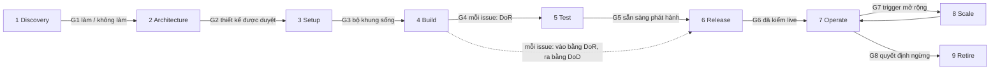

# Nghiên cứu playbook dự án mới và thiết kế bộ kit

Ghi chú nghiên cứu cho AA-1099, S279, 13/11/2026. Người viết: Claude Code (lane nghiên cứu). Chỉ đọc: không sửa
code, không gọi cloud, không gọi dịch vụ trả phí. Dữ kiện về AA lấy từ các repo (`master` của repo gốc, `origin/main`
của từng app) và mỗi dữ kiện đều trỏ tới đường dẫn nguồn. Mọi nhận định về một khung chuẩn hay công cụ bên ngoài đều
có URL nguồn ở mục [Nguồn](#8-nguồn). Bảng thực hành đầy đủ nằm ở [danh mục](inventory.vi.md). Issue đi kèm AA-1098
(trang học liệu của AA) dùng bộ kit này làm một trong các khoá học cốt lõi.

ID của trang nằm dưới CAT-01 (engineering handbook) vì đây là ghi chú nghiên cứu cho handbook. Nó không chiếm slot
GUIDE-08 ("Add a new app") của catalog; slot đó vẫn ở trạng thái dự kiến và sau này do trang Setup của bộ kit lấp
([5.2](#52-cấu-trúc-docsplaybook)).

**Trang quyết định:** thiết kế và các quyết định ở [mục 7](#7-quyết-định-cho-tech-lead) cũng được trình bày trên một
trang artifact cho tech lead. Link: *thêm vào khi agent điều phối đăng trang* (cùng lúc ghi vào
[`docs/artifacts/registry.json`](../../artifacts/registry.json)).

## Tóm tắt

- **AA đã có phần lớn một bộ kit cho dự án mới.** [Danh mục](inventory.vi.md) liệt kê 161 thực hành: 101 dùng chung,
  dùng lại được nguyên; 55 là mẫu chung nhưng gắn với tên và công cụ của AA; 5 là chi tiết sản phẩm và vận hành
  riêng của AA, thuộc về trang học liệu chứ không thuộc bộ kit.
- **Cái còn thiếu là hai đầu của vòng đời và phần đóng gói.** Chưa có pha discovery, project charter, sổ rủi ro, RACI
  hay checklist ngừng sản phẩm. Chưa có repo mẫu, chưa có hướng dẫn "thêm một app mới" (GUIDE-08 vẫn đang ở trạng
  thái dự kiến), và các skill của agent viết bằng tiếng Việt, gắn cứng với đường dẫn AA.
- **Đề xuất: dựng một "bản áp dụng AA" mỏng đặt trên các chuẩn nổi tiếng, không tạo phương pháp mới.** Chín pha vòng
  đời, mỗi pha một cổng, theo mô hình pha của UK GDS. Luồng Kanban có giới hạn WIP. Dung sai kiểu PRINCE2 để agent tự
  làm trong giới hạn đã thống nhất và chỉ báo lên khi dự báo vượt. Cổng là checklist ngắn chấm đỏ, vàng hoặc xanh
  (lựa chọn của AA). Chỉ số DORA và các năng lực AI của DORA làm phép
  kiểm sức khoẻ. Canvas arc42 và C4 cho kiến trúc. OWASP ASVS mức 1 làm cổng bảo mật khi phát hành.
- **Đóng gói thành bốn thứ:** `docs/playbook/` (mỗi pha một trang, viết theo kiểu handbook-first để trang học liệu
  hiển thị từ cùng một nguồn), các mẫu còn thiếu trong `docs/templates/`, một repo mẫu Copier để dự án mới sinh ra và
  sau này cập nhật từ đó, và các skill agent dùng chung kèm một lớp phủ AA.
- **Công sức: khoảng 9,5 phiên công việc; khoảng 5 phiên trên đường găng** khi các mẫu xong trước, rồi repo mẫu,
  skill chung và các trang playbook chạy thành lane song song ([mục 6](#6-triển-khai-và-công-sức)).
- **Chi phí dựng bộ kit: 0 USD** (công cụ mã nguồn mở, GitHub Actions miễn phí cho repo public, không thêm dịch vụ
  cloud nào). **Chi phí chạy mỗi dự án mới thì không bằng 0:** bộ khung trên Dev tốn khoảng 10 đến 35 USD mỗi tháng
  khi dùng chung nền tảng và khoảng 80 đến 120 USD mỗi tháng khi chạy riêng ([chi phí](#chi-phí)). Con số này được báo
  giá ở cổng G1.
- **Mười bốn quyết định cho tech lead** nằm ở [mục 7](#7-quyết-định-cho-tech-lead), mỗi quyết định có một câu trả lời
  đề xuất, kèm theo sau là [bản nháp issue dựng bộ kit](#71-bản-nháp-issue-dựng-bộ-kit) sẵn sàng để tạo.

## 1. Lý do và mục tiêu

### 1.1 Vấn đề

Tech lead yêu cầu (S279) một bộ tài liệu chuẩn về kỹ thuật, quy trình, quản trị và quản lý. Một dự án mới phải áp
dụng được ngay và chạy trọn vòng đời sản phẩm mà không phải nghĩ lại luật từ đầu.

AA đã xây các luật này qua khoảng 280 phiên, phần lớn là để phản ứng với lỗi thật. Chúng chạy tốt, nhưng:

- **Nằm rải rác.** Luật nằm trong [engineering handbook](../../engineering-handbook.md), [chuẩn dữ
  liệu](../../architecture/data-standards/README.md), 32 ADR (33 file kể cả mục lục), 11 skill, 7 hook agent, [sổ bài
  học](../../../skill/aa-lessons/lessons.md) (447 dòng) và bốn file `CONTEXT.md` của app. Riêng `CONTEXT.md` của
  CIS đã khoảng 530 KB.
- **Gắn với AA.** Skill và hook nêu tên repo, service, tài khoản và người của AA. Dự án mới không chép được.
- **Một phần nằm riêng.** Có những luật làm việc chỉ nằm trong memory của agent, không có trong repo (xem
  [3.3](#33-khoảng-trống)).
- **Hở ở hai đầu.** Vòng đời trong handbook ([§3](../../engineering-handbook.md#3-lifecycle-stages)) bắt đầu ở "một ý
  tưởng thành issue Linear" và kết thúc ở "báo cho bên kinh doanh". Không có gì nói về việc quyết định có bắt đầu hay
  không, hay cách tắt một sản phẩm.

### 1.2 Mục tiêu

Mục tiêu đánh số O1 tới O6 để không trùng với tên cổng G1 tới G8.

| # | Mục tiêu | Đo bằng |
|---|---|---|
| O1 | Dự án mới chạy được bộ khung sống trên Dev trong hai phiên đầu | Xong checklist ngày đầu: repo từ mẫu, CI xanh, `/health` trả SHA của commit trên Dev |
| O2 | Mỗi pha vòng đời từ discovery tới retirement có sản phẩm bàn giao, cổng và người chịu trách nhiệm | Bản đồ vòng đời bên dưới, không pha nào thiếu mẫu |
| O3 | Một nguồn sự thật nuôi playbook, tài liệu AA và trang học liệu | Mẫu chỉ nằm một chỗ trong `docs/templates/`; bộ kit chép chúng dưới guard chép từng byte |
| O4 | Dự án tiếp tục nhận cải tiến của bộ kit sau ngày đầu | `copier update` chạy được trên dự án đã sinh |
| O5 | Sẵn sàng cho agent và không phụ thuộc nhà cung cấp | `AGENTS.md` là nguồn chỉ dẫn; hook và skill ở lớp chung không có tên AA |
| O6 | Quy mô startup | Hai môi trường, không công cụ trả phí, danh sách ["Do not do now"](../../engineering-handbook.md#93-do-not-do-now) của handbook vẫn đúng |

### 1.3 Không phải mục tiêu

- Tuân thủ ISO, lấy chứng chỉ hay mua tiêu chuẩn.
- Một phương pháp mới. Bộ kit nêu rõ chuẩn nó theo cho từng phần.
- Chuyển các repo AA hiện có sang mẫu. AA là ứng dụng tham chiếu; chỉnh tay cho khớp ở chỗ có ích.
- Một MVP. Đây là thiết kế đầy đủ; việc triển khai chia giai đoạn ở [mục 6](#6-triển-khai-và-công-sức).

## 2. Bản đồ vòng đời

### 2.1 Các pha và cổng

Chín pha, ánh xạ sang các pha của UK GDS (discovery, alpha, beta, live, retirement) và sang 12 bước của handbook. Mỗi
pha kết thúc ở một cổng. Cổng là một checklist ngắn tự đánh giá đỏ, vàng hoặc xanh. Tên pha lấy từ GDS; cách chấm đỏ /
vàng / xanh là lựa chọn riêng của AA, không phải luật của GDS. Xanh thì qua. Vàng thì qua nhưng ghi lại việc cần làm
tiếp. Đỏ thì dừng.



| # | Pha | Pha GDS | Bước trong handbook | Cổng | Người chịu trách nhiệm cuối |
|---|---|---|---|---|---|
| 1 | Discovery | Discovery | trước bước 1 (mới) | G1 làm / không làm | Business owner |
| 2 | Architecture | Alpha | 4 Design | G2 thiết kế được duyệt | Tech lead |
| 3 | Setup | Alpha | hôm nay chưa có (playbook ADR 0008) | G3 bộ khung sống trên Dev | Tech lead |
| 4 | Build | Beta | 1-3, 5 | G4 mỗi issue: Definition of Ready (cổng vào; Build không có cổng ra của pha, mỗi issue ra qua G5 và G6) | Tech lead |
| 5 | Test | Beta | 6 | G5 sẵn sàng phát hành | Tech lead |
| 6 | Release | Beta / live | 7-8, 12 | G6 Definition of Done, đã kiểm live | Tech lead |
| 7 | Operate | Live | 9-11 | các đợt rà soát định kỳ | Tech lead |
| 8 | Scale | Live | 11 (dung lượng) | G7 một trigger mở rộng đo được kích hoạt, hoặc prod đầu tiên | Business owner |
| 9 | Retire | Retirement | hôm nay chưa có (mới) | G8 ngừng xong, không còn chi phí sót | Business owner |

Cổng G1 tới G3 và G5 tới G8 khép một pha. G4 là cổng duy nhất chạy theo từng issue ở đầu pha Build; nó thay
cho cổng ra của Build. Pha 4 đến 6 lặp lại cho từng issue. Khi đã live, một dự án ở nhiều pha cùng lúc: vừa build issue mới vừa vận hành
những gì đã phát hành.

### 2.2 Vai trò (RACI theo pha)

Mỗi pha có đúng một người chịu trách nhiệm cuối (Accountable). Điều này theo luật RACI phổ biến: một Accountable
cho mỗi sản phẩm bàn giao (hướng dẫn RACI của Atlassian ở [Nguồn](#8-nguồn)). "Agent có thể là người thực hiện
(Responsible), không bao giờ là Accountable" là luật riêng của AA, không phải dữ kiện của khung chuẩn: nó chính thức
hoá luật của AA là subagent không bao giờ merge ([`skill/ai-nghiep/SKILL.md`](../../../skill/ai-nghiep/SKILL.md) §3).

| Pha | Business owner | Tech lead | Agent điều phối | Subagent / agent thứ hai | CI | Nhà cung cấp |
|---|---|---|---|---|---|---|
| 1 Discovery | A | R | R (nghiên cứu, bản nháp) | C (lane nghiên cứu) | - | C |
| 2 Architecture | C | A | R (nháp ADR) | C (review) | - | C |
| 3 Setup | I | A | R | R (việc dựng khung) | R (lần chạy xanh đầu tiên) | C |
| 4 Build | I | A | R (gác cổng) | R (viết code) | R | - |
| 5 Test | C (UAT) | A | R | R | R | - |
| 6 Release | I (cập nhật kinh doanh) | A | R (merge, deploy, kiểm trong giai đoạn dev) | - | R | - |
| 7 Operate | I | A | R | C | R (guard theo lịch) | C |
| 8 Scale | A (quyết định mở rộng và khoản chi mới) | R (thiết kế, bản thiết kế prod) | R | C | - | C |
| 9 Retire | A | R | R | C | R | C |

A = chịu trách nhiệm cuối, R = thực hiện, C = được hỏi ý kiến, I = được thông báo. Từ bản prod đầu tiên hoặc tenant
trả tiền đầu tiên, tech lead còn duyệt các merge rủi ro (chuẩn dữ liệu DM-11.5,
[`02-data-management.md`](../../architecture/data-standards/02-data-management.md)). Ở pha Scale, business owner là
Accountable vì pha này tồn tại để duyệt khoản chi mới; tech lead thiết kế thay đổi và chịu chất lượng kỹ thuật của nó
qua cổng Release của từng thay đổi.

**Các dạng đội khác.** Bảng trên giả định dạng đội của AA: một tech lead, một business owner và nhiều agent. Dự án mới
có thể khác, nên mẫu hỏi dạng đội ([5.4](#54-repo-mẫu-copier)):

| Dạng đội | Điều gì thay đổi |
|---|---|
| Tech lead cộng agent (AA, mặc định) | Như trên. Agent review agent cho các lớp rủi ro; code owner bật ở G7 |
| Nhiều kỹ sư cộng agent | Mỗi kỹ sư có thể là R; tech lead vẫn là A. `CODEOWNERS` được cưỡng chế từ ngày đầu, và PR thuộc lớp rủi ro cần một người duyệt ngoài CI, không chỉ agent review. Vai trò điều phối do một kỹ sư giữ trong mỗi phiên |
| Chỉ kỹ sư, không agent | Không sinh file agent, hook và skill. Dung sai thành thoả thuận làm việc của đội. Mọi PR có người review; nghi thức phiên thành một buổi rà soát ngắn hằng tuần |


### 2.3 Từng pha

Mỗi pha liệt kê sản phẩm bàn giao, câu hỏi ở cổng, những gì AA đã có hôm nay và những gì còn thiếu. "Mới" đánh dấu
một mẫu bộ kit phải thêm.

#### Pha 1: Discovery

Mục tiêu: hiểu vấn đề và quyết định có xây hay không. GDS: discovery viết lại giải pháp thành vấn đề, định lượng cái
giá của vấn đề và kết thúc bằng quyết định làm / không làm; dừng lại không phải là thất bại.

- **Sản phẩm bàn giao:** discovery brief (mới), project charter có mục tiêu, chỉ số thành công, appetite và dung sai
  (mới), bản đồ các bên liên quan và RACI (mới), sổ rủi ro đầu tiên (mới), bảng chi phí v0 (mới), ghi chú mua hay tự
  xây (mới), lượt xem dữ liệu đầu tiên và sàng lọc quyền riêng tư (các lớp dữ liệu cá nhân, các nước, nơi lưu trữ, cơ sở pháp
  lý).
- **Cổng G1:** Vấn đề có bằng chứng không? Đã định nghĩa một chỉ số thành công chưa? Appetite đã đặt theo số phiên và
  USD chưa? Cổng quyết định của ADR 0008 nói là app mới, module của app có sẵn hay client API? "Dừng" có phải là một
  lựa chọn thật không? Sàng lọc quyền riêng tư: sản phẩm có xử lý dữ liệu cá nhân không? Nếu có: những lớp dữ liệu và
  nước nào, dữ liệu sẽ nằm ở đâu (nơi lưu trữ), cơ sở pháp lý cho từng mục đích, và một lượt sàng lọc ngắn xem việc xử
  lý có rủi ro cao và cần đánh giá tác động bảo vệ dữ liệu đầy đủ không. Chi phí chạy hằng tháng của bộ khung trên Dev
  đã được báo giá chưa ([chi phí](#chi-phí))?
- **AA đã có:** cổng quyết định của ADR 0008
  ([`0008-new-app-integration-and-data-platform-rules.md`](../../adr/0008-new-app-integration-and-data-platform-rules.md)
  §2), các ghi chú nghiên cứu như [bản so sánh Odoo](../2026-11-10-odoo-tour-travel-plugin-comparison.md), ADR mô hình
  kinh doanh ([`0019-b2b-only-ecosystem-model.md`](../../adr/0019-b2b-only-ecosystem-model.md)).
- **Còn thiếu:** charter, discovery brief, bản đồ các bên liên quan, RACI, sổ rủi ro, chỉ số thành công, checklist
  mua hay tự xây.

#### Pha 2: Architecture

Mục tiêu: chọn các ranh giới khó đảo ngược và ghi chúng lại trước khi viết code.

- **Sản phẩm bàn giao:** `CONTEXT.md` theo canvas arc42 (mẫu mới), sơ đồ C4 ngữ cảnh, container và triển khai dạng
  code, các ADR đầu tiên (stack, quyền sở hữu dữ liệu, định danh, tenant, môi trường), yêu cầu chất lượng theo chín
  tên của ISO 25010, danh sách hợp đồng, dòng sở hữu schema, mô hình mối đe doạ nhẹ (mới), các dòng sổ sử dụng AI nếu
  sản phẩm dùng AI.
- **Cổng G2:** Mỗi thực thể có một bên ghi. Mọi lượt đọc chéo app đi qua một hợp đồng có tên. Mức bảo mật được chọn
  theo từng vùng (ASVS mức 1, mức 2 cho xác thực, thanh toán và dữ liệu cá nhân). Mỗi thực thể chứa dữ liệu cá nhân có
  một dòng trong sổ quyền riêng tư ([`docs/legal/register.md`](../../legal/register.md), danh mục T76) kèm thời hạn
  lưu; đánh giá tác động đã làm nếu lượt sàng lọc ở G1 nói rủi ro cao. Chi phí đã ước tính. Mô hình môi trường đã
  chọn.
- **AA đã có:** [kiến trúc hệ sinh thái](../../ecosystem-architecture.md),
  [mục lục ADR và luật đặt chỗ](../../adr/README.md), [mẫu ADR](../../templates/adr.md),
  [hợp đồng](../../contracts/README.md), [chuẩn dữ liệu](../../architecture/data-standards/README.md),
  [sở hữu schema](../../database/schema-ownership.md), [sổ sử dụng AI](../../architecture/ai-use-register.md),
  [sơ đồ dạng code](../../architecture/diagrams/README.md),
  [mô hình môi trường](../../adr/0012-environment-model.md).
- **Còn thiếu:** mẫu arc42 / C4, mô hình mối đe doạ, ADR quy ước HTTP API (số 0013 đã giữ chỗ nhưng chưa viết: tiền
  tố URL, phiên bản, dạng lỗi, phân trang, idempotency).

#### Pha 3: Setup

Mục tiêu: một bộ khung sống: một sản phẩm rỗng build được, deploy lên Dev và được quan sát, với mọi guard đã bật.

- **Sản phẩm bàn giao:** repo sinh từ mẫu, CI xanh, hook pre-push, ratchet sức khoẻ code và độ phủ test, lint tài
  liệu, quét secret, file và hook của agent, project và kế hoạch trên tracker, tài khoản cloud và role qua IaC, OIDC
  từ CI vào cloud, tag và ngân sách, sổ secret, client định danh, schema CSDL có role và migration đầu tiên, bảng
  job, sổ setting, log, theo dõi lỗi và `/health`.
- **Cổng G3:** `/health` trên Dev trả SHA của commit, do CI deploy. Mọi check xanh trên một PR rỗng. Đã có cảnh báo
  ngân sách. Probe cô lập qua nếu sản phẩm đa tenant.
- **AA đã có:** playbook 12 bước của ADR 0008 (§3: thiết kế, đăng ký chủ, role, migration đầu tiên, tenant, đọc qua
  hợp đồng, sự kiện, định danh, dịch vụ nền tảng, dữ liệu cá nhân, vận hành, probe cô lập),
  [onboarding](../../onboarding.md), bố cục Infra (`infra/AA-CIS-Infra/CONTEXT.md`),
  [chuẩn gắn tag](../../architecture/tagging-standard.md), [sổ secret](../../security/secrets-register.md).
- **Còn thiếu:** repo mẫu, hướng dẫn "thêm một app mới" (GUIDE-08, đang dự kiến trong [catalog](../../README.md)),
  cách dựng môi trường phát triển tại máy cho từng repo.

#### Pha 4: Build

Mục tiêu: biến các issue nhỏ, đã sẵn sàng thành thay đổi đã được review.

- **Sản phẩm bàn giao:** issue qua được Definition of Ready, PR là hồ sơ thay đổi, ghi chú triển khai, migration theo
  luồng expand / contract, hợp đồng kèm mẫu, dòng trong sổ flag, dòng setting, dòng bài học.
- **Cổng G4 (từng issue):** Definition of Ready trước khi bắt đầu; CI cộng review theo lớp rủi ro trước khi merge.
- **AA đã có:** [Definition of Ready](../../templates/definition-of-ready.md),
  [`aa-linear-issue`](../../../skill/aa-linear-issue/SKILL.md), [mẫu PR](../../../.github/pull_request_template.md),
  [luật migration](../../architecture/data-standards/01-engineering.md),
  [lane song song](../../../skill/aa-session/references/parallel-lanes.md), [sổ bài học](../../../skill/aa-lessons/SKILL.md).
- **Còn thiếu:** hướng dẫn phong cách code ngoài các linter (bố cục module, xử lý lỗi, mẫu async), trường appetite
  cho từng issue.

#### Pha 5: Test

Mục tiêu: chứng minh thay đổi chạy đúng trước khi người dùng thấy.

- **Sản phẩm bàn giao:** trang chiến lược kiểm thử (kiểm gì ở đâu), test unit và integration, mẫu hợp đồng,
  Playwright smoke, so sánh hình và E2E có đăng nhập, eval chống thoái lui cho thay đổi AI, probe cô lập cho thay
  đổi về tenant, báo cáo UAT cho tính năng bên kinh doanh nhìn thấy.
- **Cổng G5:** mọi check xanh, không chỉ check bắt buộc. Các lớp rủi ro đã được một agent độc lập review. Các mục
  ASVS mức 1 của vùng bị chạm đã kiểm.
- **AA đã có:** workflow CI trong từng app (ví dụ `apps/AA-CIS-App/.github/workflows/ui-smoke.yml`,
  `eval-regression.yml`), [skill kiểm UI](../../../skill/aa-ui-verify/SKILL.md),
  [mẫu báo cáo UAT](../../templates/uat-report.md), [probe cô lập](../../ops/runbooks/isolation-probe.md).
- **Còn thiếu:** trang chiến lược kiểm thử, chuẩn trợ năng (accessibility), checklist ASVS.

#### Pha 6: Release

Mục tiêu: thay đổi lên Dev (sau này prod) và được chứng minh là chạy live.

- **Sản phẩm bàn giao:** checklist phát hành, migration áp đúng thứ tự, flag được bật, kiểm sau deploy, comment bằng
  chứng đã kiểm live, release note chỉ chứa việc đã kiểm, cập nhật cho bên kinh doanh.
- **Cổng G6:** Definition of Done = đã merge, CI xanh, rollout hoàn tất, endpoint live trả đúng dạng, UI đã kiểm,
  bằng chứng đã đăng.
- **AA đã có:** [`aa-ship`](../../../skill/aa-ship/SKILL.md), [mẫu release note](../../templates/release-note.md),
  [feature flag](../../ops/feature-flags.md), [`aa-jira-update`](../../../skill/aa-jira-update/SKILL.md).
- **Còn thiếu:** checklist phát hành thành một mẫu riêng (hôm nay nằm trong `aa-ship`), trang deploy cho từng app và
  quy trình CHANGELOG (APP-01 và APP-07 đang dự kiến).

#### Pha 7: Operate

Mục tiêu: giữ hệ thống chạy, học từ mọi lỗi, theo dõi chi phí.

- **Sản phẩm bàn giao:** cảnh báo gắn với runbook, hồ sơ sự cố, postmortem, diễn tập, sao lưu, xoay vòng secret, rà
  soát quyền hằng quý, rà soát dung lượng và chi phí hằng tháng, chỉ số delivery hằng tuần, bài học thành guard.
- **Cổng:** không có cổng cố định; các đợt rà soát định kỳ là biện pháp kiểm soát.
- **AA đã có:** [mục lục vận hành](../../ops/README.md), [ứng phó sự cố](../../ops/incident-response.md),
  [postmortem](../../ops/postmortems/README.md), [diễn tập](../../ops/drills/README.md),
  [FinOps](../../ops/finops.md), [rà soát quyền](../../templates/access-review.md),
  [rà soát dung lượng](../../templates/capacity-review.md).
- **Còn thiếu:** SLO đo được, trang tổng quan khôi phục thảm hoạ, báo cáo chỉ số delivery, bản đã chạy thử của nhiều
  runbook (rollback, xoay vòng secret, break-glass, khôi phục schema vẫn UNTESTED).

#### Pha 8: Scale

Mục tiêu: chỉ lớn lên khi một trigger đo được cho phép, đòn bẩy rẻ nhất trước.

- **Sản phẩm bàn giao:** bảng trigger, rà soát dung lượng, bản thiết kế prod, công tắc quản trị giai đoạn prod (merge
  rủi ro cần tech lead, code owner được cưỡng chế), SLO kèm chính sách error budget, trực sự cố.
- **Cổng G7:** một dòng trigger mở rộng kích hoạt, hoặc đã có ngày cho bản prod đầu tiên hay tenant trả tiền đầu tiên.
- **AA đã có:** [chuẩn mở rộng](../../architecture/data-standards/03-scaling.md) (thang trigger C3, C9),
  [mô hình tài khoản gọn](../../adr/0018-lean-aws-account-model.md), quyền merge theo giai đoạn (DM-11.5).
- **Còn thiếu:** một lần chuyển giao đã chạy thử từ luật giai đoạn dev sang luật giai đoạn prod, mẫu SLO và error
  budget.

#### Pha 9: Retire

Mục tiêu: tắt một sản phẩm, app hay tính năng sạch sẽ và thôi trả tiền cho nó.

- **Sản phẩm bàn giao:** ADR ngừng, thông báo cho người dùng và tenant, xuất và xoá dữ liệu theo thời hạn lưu, ngừng
  hợp đồng bản major (chạy song song ít nhất 30 ngày), tombstone hoặc chuyển hướng, kế hoạch huỷ hạ tầng, xoá secret,
  kiểm chi phí cho thấy bằng 0, lưu trữ tài liệu, một dòng bài học cuối.
- **Cổng G8:** không còn gì chạy hay bị tính tiền, kiểm trên hoá đơn cloud và bảng kiểm kê.
- **AA đã có:** các trường hợp thật nhưng chưa có quy trình chung: việc gỡ tài khoản ghi trong
  [ADR 0001a](../../adr/0001a-retire-acc1-llm-on-acc3-only.md), ngừng tour trong
  [ADR 0015](../../adr/0015-tour-liveness-and-retirement-propagation.md),
  [sổ bảng chết](../../architecture/dead-table-registry.md),
  [DRY RUN cho thao tác xoá](../../../skill/aa-cis-schema/references/destructive-ops.md).
- **Còn thiếu:** checklist ngừng sản phẩm dùng chung.

### 2.4 Kiểm độ phủ theo ISO/IEC/IEEE 12207

Chuẩn này gom các quy trình vòng đời thành bốn nhóm. Ở đây chỉ dùng nó làm phép thử "có quên nguyên một mảng nào
không", không dùng để tuân thủ.

| Nhóm 12207 | Bộ kit phủ ở đâu | Khoảng trống |
|---|---|---|
| Thoả thuận (mua, cung cấp) | Cách làm việc với nhà cung cấp trong [`stakeholders-english.md`](../../../skill/ai-nghiep/references/stakeholders-english.md), [sổ quyền riêng tư](../../legal/register.md) | Chưa có checklist chọn nhà cung cấp hay rà soát hợp đồng |
| Hỗ trợ dự án ở cấp tổ chức (mô hình vòng đời, hạ tầng, danh mục dự án, nhân sự, chất lượng, tri thức) | Chính playbook, handbook, trang học liệu (AA-1098) cho tri thức | Chưa có ma trận năng lực; chỉ có một danh mục sản phẩm |
| Quản lý kỹ thuật (lập kế hoạch, đánh giá và kiểm soát, quyết định, rủi ro, cấu hình, thông tin, đo lường, đảm bảo chất lượng) | Backlog và kế hoạch, ADR, git, catalog tài liệu, CI | Chưa có sổ rủi ro; chưa có chỉ số delivery |
| Quy trình kỹ thuật (nhu cầu, yêu cầu, kiến trúc, thiết kế, triển khai, tích hợp, kiểm chứng, chuyển giao, thẩm định, vận hành, bảo trì, loại bỏ) | Pha 1 tới 9 | Loại bỏ trước đây không có quy trình: nay là pha 9 |

## 3. Danh mục thực hành

### 3.1 Số lượng

Bảng đầy đủ, mỗi dòng có đường dẫn nguồn và "bản chung phải đổi gì", nằm ở [danh mục](inventory.vi.md).

| Phần | Thực hành | Dùng chung (G) | Mẫu, cần tham số (P) | Riêng AA (A) |
|---|---|---|---|---|
| Kỹ thuật | 85 | 47 | 33 | 5 |
| Quy trình | 34 | 23 | 11 | 0 |
| Quản trị | 24 | 21 | 3 | 0 |
| Quản lý | 18 | 10 | 8 | 0 |
| **Tổng** | **161** | **101** | **55** | **5** |

Năm dòng riêng AA là chi tiết sản phẩm và vận hành của AA: hai dòng là kiến thức sản phẩm (pipeline nội dung CIS,
nghiệp vụ Booking và Partner) và ba dòng là cách đấu nối vận hành của AA (T33 định tuyến tài khoản LLM, T45 runbook
DB Migrate và exec, T78 trang chi tiêu trong admin). Chúng chuyển sang trang học liệu.

**Cách xếp phạm vi.** AA-1099 xếp "DRY RUN" vào quy trình và "chuẩn dữ liệu" vào quản trị. Danh mục xếp chúng vào Kỹ
thuật (T43 cho DRY RUN; T35, T36 và T38 cho chuẩn dữ liệu) vì nguồn của chúng là tài liệu kỹ thuật. Số đếm ở trên theo
danh mục, nên không khớp một-một với cách nhóm của issue. Hãy đọc bốn dòng đó như cũng thuộc Quy trình (T43) và Quản
trị (T35, T36, T38); [danh mục](inventory.vi.md) có cùng ghi chú này.

### 3.2 Bản chung phải đổi gì

Phần lớn các dòng "P" cần cùng vài thay đổi:

1. **Tên thành tham số:** danh sách repo, tên service, tiền tố mã issue, tracker, nơi lưu memory, tài khoản cloud.
2. **Ngôn ngữ:** skill chung viết tiếng Anh; lớp phủ AA có thể giữ tiếng Việt
   ([quy ước ngôn ngữ](../../../.kiro/steering/language-convention.md)).
3. **Tuỳ chọn thay vì một hình dạng:** một repo hay repo gốc cộng repo app, đa tenant hay không, có tính năng AI hay
   không.
4. **File agent:** `AGENTS.md` là nguồn, `CLAUDE.md` import nó, thay cho `.kiro/steering` cộng `.claude/CLAUDE.md`.
5. **Tách khối luật:** luật lane ([`lane.js`](../../../tools/workflows/lane.js) phần COMMON), shell guard và sổ bài
   học đều trộn dòng chung với dòng chỉ của AA; tách thành một khối chung và một khối AA.

### 3.3 Khoảng trống

Sắp theo mức độ chặn bộ kit.

| # | Khoảng trống | Bằng chứng | Cách bộ kit xử lý |
|---|---|---|---|
| 1 | Không có pha discovery: không charter, brief, bản đồ các bên liên quan, chỉ số thành công | Handbook [§3](../../engineering-handbook.md#3-lifecycle-stages) bắt đầu ở một issue Linear | Các mẫu pha 1 |
| 2 | Không có sổ rủi ro | Rủi ro chỉ nằm trong `milestones[].risks` của [`plan.json`](../../backlog/tracker/plan.json) | Mẫu sổ rủi ro (RAID) |
| 3 | Không có RACI | Vai trò rải ở handbook §2.3, hướng dẫn giọng văn và ma trận duyệt | RACI ở [2.2](#22-vai-trò-raci-theo-pha) và một mẫu |
| 4 | Không có quy trình ngừng | Chỉ có hồ sơ từng trường hợp (ADR 0001a, ADR 0015) | Checklist ngừng |
| 5 | Không có hướng dẫn "thêm một app mới" | GUIDE-08 đang dự kiến trong [catalog](../../README.md) | Trang pha 3 cộng repo mẫu |
| 6 | Không có repo mẫu | Mỗi repo dựng tay | Mẫu Copier |
| 7 | Luật chỉ nằm trong memory riêng của agent: quyết thay vì hỏi, không tự đặt cổng, chạy trả phí theo tập con, báo giá trước mọi dịch vụ trả phí, kiểm live trước khi khẳng định, báo cáo cho chủ doanh nghiệp gói trong một trang; luật "mọi ngưỡng là setting quản trị viên sửa được" đã có cho CIS (danh mục T18, V20) nhưng chưa thành luật cho mọi app | Không có trong file nào của repo áp dụng cho cả hệ sinh thái đã merge (luật ngưỡng đang theo dõi ở AA-1096) | Chuyển vào handbook hoặc skill trước khi dựng bộ kit (quyết định D11) |
| 8 | Luật cũ hoặc mâu thuẫn giữa các nguồn | Hướng dẫn vai trò "song ngữ cạnh nhau" (`ai-nghiep`) so với file `.vi.md` (quy ước ngôn ngữ); phạm vi guard tiêu đề PR khác nhau giữa `aa-linear-issue` và `aa-ship`; DM-11.1 nói ADR 0009 chưa viết nhưng nó đã có; [`finops.md`](../../ops/finops.md) vẫn mô tả bố trí tài khoản LLM từ trước S278; [`docs/audits/README.md`](../../audits/README.md) không phải mục lục của mọi audit | Một PR dọn dẹp trước khi bộ kit chép bất cứ gì |
| 9 | ADR 0011 và ADR 0014 vẫn Proposed dù đang dùng hằng ngày; quyết định D-14 trong handbook ("repo gốc private") đã cũ từ khi repo gốc chuyển public | [`0011`](../../adr/0011-github-app-identity-and-merge-rights.md), [`0014`](../../adr/0014-repo-visibility-and-github-plan.md), [handbook §9](../../engineering-handbook.md) D-14 | Tech lead chấp nhận hoặc sửa; cần trước khi có repo mẫu public (D13) |
| 10 | Không có trang chiến lược kiểm thử | Test rải trong workflow và skill | Mẫu chiến lược kiểm thử |
| 11 | Không có mô hình mối đe doạ | Kiến thức bảo mật rải ở baseline, luật SEC và `CONTEXT.md` | Mẫu mô hình mối đe doạ nhẹ |
| 12 | Chưa viết ADR quy ước HTTP API | ADR 0013 đã giữ chỗ | Viết thành một phần của bộ kit (ADR chung) |
| 13 | Không có mẫu SLO hay error budget; không có chỉ số delivery (DORA) | Chỉ có luật trong [03-scaling](../../architecture/data-standards/03-scaling.md) C1 | Mẫu SLO, báo cáo DORA |
| 14 | Nhiều runbook UNTESTED | Cột trạng thái trong [mục lục vận hành](../../ops/README.md) | Mẫu mang theo luật đã chạy thử; diễn tập của AA ở lại backlog AA |
| 15 | Thiếu thứ tự học được: `CONTEXT.md` của CIS khoảng 530 KB, của Partner khoảng 380 KB | Kích thước theo `git show origin/main:CONTEXT.md` | Trần dung lượng trong mẫu `CONTEXT.md`; trang theo module (cũng là đầu vào cho LMS) |
| 16 | Không có chuẩn trợ năng, không có hướng dẫn phong cách code, không có hướng dẫn chạy tại máy cho từng repo | Luật UI kit chỉ nằm trong code | Ba mẫu ngắn |
| 17 | Không có checklist chọn nhà cung cấp; không có ma trận năng lực | Chỉ có hướng dẫn giọng văn với nhà cung cấp | Checklist nhà cung cấp (dựa trên 18F); ma trận năng lực thuộc AA-1098 |

## 4. So sánh với các khung chuẩn

Kết luận: **adopt** (lấy nguyên), **adapt** (lấy ý tưởng ở dạng nhẹ hơn của AA), **skip** (quá mức ở quy mô này).
Mọi mục bị bỏ dưới đây đều đã có trong danh sách ["Do not do now"](../../engineering-handbook.md#93-do-not-do-now) của
handbook hoặc khớp với danh sách đó.

| Khung | Cung cấp gì | Kết luận | Bộ kit lấy gì | Bỏ gì |
|---|---|---|---|---|
| ISO/IEC/IEEE 12207:2017 | Các quy trình vòng đời trong bốn nhóm; phụ lục tuỳ biến; không ép mô hình | Adapt | Bốn nhóm làm phép kiểm độ phủ ([2.4](#24-kiểm-độ-phủ-theo-isoiecieee-12207)) | Tuân thủ, sản phẩm cho từng quy trình, mua chuẩn |
| ISO/IEC 25010:2023 | Chín đặc tính chất lượng sản phẩm (thêm an toàn; đổi tên usability và portability) | Adopt | Chín tên làm đề mục cho yêu cầu chất lượng và checklist phát hành | Chương trình đo lường đầy đủ |
| PMBOK Guide, bản 7 (2021) | Mười hai nguyên tắc và tám miền hiệu quả: các bên liên quan, đội, cách tiếp cận phát triển và vòng đời, lập kế hoạch, công việc dự án, delivery, đo lường, bất định | Adapt | Bốn miền làm checklist cho mẫu quản lý: các bên liên quan (bản đồ các bên liên quan), lập kế hoạch (charter, bảng chi phí), đo lường (chỉ số), bất định (sổ rủi ro) | Kế hoạch cho từng mảng kiến thức, earned value |
| PRINCE2 7 | Quản lý theo giai đoạn, quản lý theo ngoại lệ với dung sai (thời gian, chi phí, phạm vi, chất lượng, rủi ro, lợi ích) | Adapt | Cổng giai đoạn; dung sai làm luật tự chủ của agent; học từ kinh nghiệm = sổ bài học | Ban dự án, bộ mô tả sản phẩm đầy đủ, chứng chỉ |
| Scrum Guide 2020 | Product Goal, Definition of Done, review và retrospective | Adapt | Product Goal trong charter; DoD; đóng phiên làm retro | Sprint, họp đứng hằng ngày, Scrum Master |
| Kanban Guide | Trực quan hoá, giới hạn WIP, quản lý luồng; WIP, throughput, tuổi việc, cycle time | Adopt | Giới hạn WIP (đã có 8 In Progress), bốn chỉ số luồng, cam kết mức dịch vụ về sau | Dự báo Monte Carlo khi chưa có lịch sử |
| Shape Up | Appetite thay cho ước lượng, định hình trước khi xây, cầu dao; phụ lục nói đội nhỏ bỏ các chu kỳ | Adapt | Appetite cho từng issue, cầu dao cho lần chạy trả phí và issue bị kẹt | Chu kỳ sáu tuần, bàn đặt cược |
| Chỉ số DORA | Năm chỉ số delivery: lead time, tần suất deploy, thời gian khôi phục, tỉ lệ thay đổi lỗi, tỉ lệ làm lại | Adopt | Tính hằng tuần bằng một script rẻ từ git, lượt deploy và hồ sơ sự cố | Dashboard hay công cụ trả phí khi chưa có traffic prod |
| Năng lực DORA và mô hình AI | Danh mục năng lực; bảy năng lực AI | Adopt | Bảy năng lực AI làm phép kiểm sẵn sàng cho agent ([5.8](#58-đo-lường)) | Đánh giá năng lực đầy đủ |
| Google SRE | SLO do bên kinh doanh đặt, chính sách error budget, postmortem không đổ lỗi kèm điều kiện kích hoạt | Adapt | Mỗi service hướng người dùng một SLO, chính sách error budget một trang, điều kiện kích hoạt postmortem; bật khi có prod đầu tiên | Cảnh báo theo tốc độ đốt và trực sự cố trên Dev |
| Mô hình C4 | Ngữ cảnh, container, component, code; ngữ cảnh và container là đủ cho phần lớn đội | Adopt | Hình ngữ cảnh, container và triển khai dạng code | Hình component và code vẽ tay |
| arc42 | Mẫu kiến trúc 12 mục miễn phí, kèm canvas một trang | Adapt | Canvas làm khung cho `CONTEXT.md`; mục 9 trỏ ADR, mục 10 dùng ISO 25010, mục 11 là sổ rủi ro | Điền đủ 12 mục từ ngày đầu ("full arc42" có trong "Do not do now") |
| MADR và Thoughtworks Radar về ADR | Mẫu ADR tối giản (CC0). Radar: "Lightweight Architecture Decision Records" từng ở Adopt và xuất hiện lần cuối vào tháng 5/2018; nay không còn trên radar. Cảnh báo rằng tài liệu cũ hay tài liệu ồ ạt làm agent hiểu sai đến từ mục Caution "AI-driven documentation sprawl" trên trang kỹ thuật hiện tại | Adopt | Dạng MADR tối giản; một bước dọn / thay thế | Một công cụ quyết định riêng |
| Thoughtworks Radar, kỹ thuật cho agent | Mở dần ngữ cảnh, sandbox cho agent, bánh đà phản hồi; "curated shared instructions" chỉ xuất hiện như một mục liên quan, không phải mục chính; cảnh báo phình chỉ dẫn và tràn lan tài liệu do AI | Adopt | File chỉ dẫn gốc gọn, skill nạp khi cần, hook làm sandbox, sổ bài học làm bánh đà, AA-CIS làm ứng dụng tham chiếu | Công cụ spec-driven (vẫn ở "assess") |
| AGENTS.md | Định dạng Markdown mở cho chỉ dẫn agent, do Linux Foundation quản lý | Adopt | `AGENTS.md` là nguồn, `CLAUDE.md` import nó | File riêng của một nhà cung cấp làm nguồn |
| Twelve-Factor App | Mười hai luật thiết kế app; cộng đồng duy trì từ 2024; luật III đặt cấu hình trong biến môi trường | Adopt, kèm một giới hạn nêu rõ | Checklist thiết kế app trong pha Setup. Luật III chỉ áp cho cấu hình triển khai: endpoint, tham chiếu secret, công tắc theo môi trường. Giá trị chính sách (ngưỡng, giới hạn, trần) theo luật của AA (AA-1096, danh mục T18, V20) và nằm trong sổ setting quản trị viên sửa được, không nằm trong biến môi trường. Hai luật không mâu thuẫn khi tách cấu hình như vậy, và bộ kit ghi rõ cách tách này | Không bỏ gì |
| Trunk-based development | Branch sống ngắn, CI trên trunk, merge queue khi lớn | Adopt | Luồng của AA như hiện nay | Không bỏ gì |
| OWASP SAMM v2 | Năm chức năng, 15 thực hành, ba mức; chọn mục tiêu theo rủi ro | Adapt | Mỗi dự án một lần tự đánh giá nhẹ, phần lớn ở mức 1 | Đánh giá đầy đủ hằng năm, mức 3 ("full SAMM" có trong "Do not do now") |
| OWASP ASVS 5.0 | Yêu cầu kiểm chứng theo ba mức; "most applications will aim for Level 2" (hướng dẫn cho lập trình viên của OWASP) | Adopt | Mức 1 làm cổng phát hành; mức 2 cho vùng xác thực, thanh toán và dữ liệu cá nhân | Mức 3 làm mặc định |
| FinOps Framework | Inform, optimise, operate; crawl / walk / run cho từng năng lực; chi phí token | Adapt | Bảng chi phí, tag từ ngày đầu, rà soát hằng tháng, sổ cái token theo stage; ở mức crawl / walk | Mức run ở mọi nơi |
| ITIL 4 | Change enablement, quản lý sự cố | Adapt | "Standard change" = một PR xanh theo luật quyền merge; hồ sơ sự cố nhẹ | CAB, CMDB, công cụ ITSM |
| RACI | Một Accountable cho mỗi sản phẩm bàn giao. "Agent không bao giờ là Accountable" là luật riêng AA thêm vào, không thuộc RACI | Adopt | RACI theo pha ([2.2](#22-vai-trò-raci-theo-pha)) | RACI cho từng việc |
| UK GDS Service Manual và Standard | Discovery, alpha, beta, live, retirement; chuẩn 14 điểm; discovery viết lại giải pháp thành vấn đề, định lượng cái giá của nó, và dừng lại không phải thất bại | Adapt | Tên pha và câu hỏi cổng trên một bộ điểm rút gọn của chuẩn; cách chấm đỏ / vàng / xanh là lựa chọn riêng của AA | Hội đồng đánh giá bên ngoài |
| Hướng dẫn 18F (đã lưu trữ, public domain) | Hướng dẫn giảm rủi ro: mua hay tự xây, lập ngân sách, quản lý nhà cung cấp | Adapt | Checklist mua hay tự xây và checklist nhà cung cấp | Không bỏ gì (tài liệu tham chiếu đã đóng băng) |
| GitLab handbook-first | Handbook là nguồn duy nhất; sửa nó trước rồi mới thông báo | Adopt | Trang playbook là nguồn; trang học liệu hiển thị từ đó | Một handbook cỡ GitLab |
| Copier, cookiecutter kèm cruft, Backstage | Copier ghi lại câu trả lời, có sẵn `copier update` và migration theo phiên bản; cookiecutter sinh một lần, còn cruft thêm `cruft link` và `cruft update` để dự án cookiecutter giữ đồng bộ với mẫu; Backstage cần một portal | Adopt Copier | Repo mẫu Copier, đồng thời đánh dấu là GitHub template | cruft (công cụ thứ hai cho việc Copier tự làm được); Backstage (có trong "Do not do now") |

Lưu ý từ lane nghiên cứu: dòng PMBOK chỉ dùng bản 7, như hình của PMI được trích; bản 8 đổi tên một số miền và không
được dùng ở đây. Các vùng dung sai của PRINCE2 7 lấy từ nguồn thứ cấp. Định nghĩa các loại thay đổi của ITIL chưa đọc
được đầy đủ. Trang blog của PMI về RACI (HTTP 403) không đọc được, nên không nhận định nào dựa vào nó. Kiểm lại các
điểm này trước khi bộ kit trích chúng như luật.

## 5. Thiết kế bộ kit

### 5.1 Nguyên tắc

1. **Bản áp dụng trên chuẩn.** Mỗi trang của bộ kit nêu chuẩn nó theo và nói AA giữ hay bỏ gì.
2. **Mỗi dữ kiện một nhà.** Mẫu chỉ nằm một chỗ trong [`docs/templates/`](../../templates/); trang pha trỏ tới chúng;
   repo mẫu chép chúng dưới guard chép từng byte, giống UI kit ([ADR 0016](../../adr/0016-one-design-system-guarded-kit-copies.md)).
3. **Handbook-first.** Một luật đổi ở trang bộ kit trước, rồi mới tới skill và các bản sao. Trang học liệu (AA-1098)
   hiển thị từ cùng các trang đó.
4. **Lõi chung cộng lớp phủ.** Bộ kit không có tên AA. AA giữ một lớp phủ (tài khoản, service, người, Notion, Jira)
   trỏ về các trang chung.
5. **Dung sai, không phải xin duyệt.** Agent làm trong giới hạn đã thống nhất và chỉ báo lên khi dự báo vượt
   (PRINCE2).
6. **Công tắc theo giai đoạn.** Các biện pháp chỉ dành cho prod (error budget, trực sự cố, code owner được cưỡng chế,
   role agent quyền tối thiểu) được viết ngay bây giờ và bật ở G7, không sớm hơn.
7. **Dọn bớt.** Mỗi trang có chủ và khoảng thời gian rà soát; luật bị thay thì xoá, không giữ cạnh luật mới.

### 5.2 Cấu trúc `docs/playbook/`

```text
docs/playbook/
  README.md                    mục lục: bản đồ vòng đời, cổng, RACI, cách bắt đầu (+ .vi.md)
  principles.md                bảy nguyên tắc và bảng dung sai
  01-discovery.md              mỗi pha một trang: mục tiêu, sản phẩm bàn giao, checklist cổng (RAG),
  02-architecture.md           mẫu cần dùng, ví dụ tham chiếu từ AA, lỗi hay gặp
  03-setup.md                  (lấp slot GUIDE-08 "Add a new app" đang dự kiến trong catalog)
  04-build.md
  05-test.md
  06-release.md
  07-operate.md
  08-scale.md
  09-retire.md
  agents.md                    điều phối agent: vai trò, lane, rào chắn, nghi thức phiên, skill
  adoption.md                  checklist ngày đầu và kế hoạch 30/60/90 ngày
  metrics.md                   chỉ số DORA và luồng, phép kiểm sẵn sàng AI
  aa-profile.md                bản áp dụng AA: AA ánh xạ lên bộ kit thế nào: con trỏ lớp phủ, luật chỉ của AA
```

Mỗi trang có một file anh em `.vi.md`. Catalog ([`docs/README.md`](../../README.md)) thêm một mục cho playbook sau khi
được duyệt.

### 5.3 Các mẫu

Mọi mẫu đặt trong [`docs/templates/`](../../templates/). "Đã có" nghĩa là bộ kit chỉnh file của AA; "mới" nghĩa là bộ
kit viết mới.

| Mẫu | Pha | Trạng thái | Dựng từ |
|---|---|---|---|
| Discovery brief | 1 | Mới | GDS discovery; 18F mua hay tự xây |
| Project charter (mục tiêu, chỉ số thành công, appetite, dung sai, ngoài phạm vi) | 1 | Mới | Các miền PMBOK; dung sai PRINCE2; Product Goal của Scrum |
| Bản đồ các bên liên quan và RACI | 1 | Mới | Luật RACI; handbook [§2.3](../../engineering-handbook.md#23-roles) |
| Sổ rủi ro (RAID: rủi ro, giả định, vấn đề, phụ thuộc) | 1, rồi mọi pha | Mới | arc42 mục 11; rủi ro trong `plan.json` |
| Bảng chi phí (chi phí đơn vị, dự báo tháng, các khoản trả phí kèm lời đồng ý) | 1, rồi 7 | Mới | [FinOps](../../ops/finops.md); [báo cáo chi phí](../../templates/cost-report.md) |
| Checklist chọn nhà cung cấp | 1, 2 | Mới | Hướng dẫn giảm rủi ro của 18F |
| `CONTEXT.md` theo canvas arc42 kèm hình C4 | 2 | Mẫu mới, đã có khuôn | arc42; C4; các file `CONTEXT.md` của app |
| ADR | 2, rồi mọi pha | Đã có: [`adr.md`](../../templates/adr.md) | Thêm biến thể MADR tối giản và bước dọn |
| Mô hình mối đe doạ nhẹ (STRIDE theo container) | 2 | Mới | Khoảng trống 11 |
| Quy ước HTTP API (ADR chung) | 2 | Mới | Khoảng trống 12 |
| Hợp đồng (JSON Schema, mẫu hợp lệ và không hợp lệ, dòng trong sổ) | 2, 4 | Đã có dạng luật: [hợp đồng](../../contracts/README.md) | Mẫu thư mục |
| File migration (header expand / contract, tự đăng ký) | 3, 4 | Đã có dạng luật: MIG-1..14 | Mẫu file |
| Dòng sổ setting kèm hướng dẫn cho người vận hành | 3, 4 | Đã có trong code CIS | Mẫu dòng và hướng dẫn |
| Definition of Ready | 4 | Đã có: [`definition-of-ready.md`](../../templates/definition-of-ready.md) | Thêm trường appetite |
| Ghi chú triển khai | 4 | Đã có: [`docs/implementation-notes/`](../../implementation-notes/) | Giữ nguyên |
| Chiến lược kiểm thử | 5 | Mới | Khoảng trống 10 |
| Checklist bảo mật (ASVS 5.0 mức 1, SAMM nhẹ) | 5, 6 | Đã có một phần: [security baseline](../../security/baseline.md) | Ánh xạ lại theo ASVS |
| Báo cáo UAT | 5 | Đã có: [`uat-report.md`](../../templates/uat-report.md) | Giữ nguyên |
| Checklist phát hành (DoD, các trục ISO 25010, mục AI, flag, migration) | 6 | Đã có trong [`aa-ship`](../../../skill/aa-ship/SKILL.md) | Tách ra thành một trang |
| Release note | 6 | Đã có: [`release-note.md`](../../templates/release-note.md) | Giữ nguyên |
| Runbook | 7 | Đã có: [`runbook.md`](../../templates/runbook.md) | Giữ nguyên, kèm luật đã chạy thử |
| Hồ sơ sự cố | 7 | Mới, nhẹ | [Ứng phó sự cố](../../ops/incident-response.md); ITIL |
| Postmortem | 7 | Đã có: [`postmortem.md`](../../templates/postmortem.md) | Thêm danh sách điều kiện kích hoạt của SRE |
| Sổ bài học | 4, 7 | Đã có: [`aa-lessons`](../../../skill/aa-lessons/SKILL.md) | Sổ rỗng cộng bộ kiểm trường Guard |
| Rà soát dung lượng, rà soát quyền | 7 | Đã có: [`capacity-review.md`](../../templates/capacity-review.md), [`access-review.md`](../../templates/access-review.md) | Giữ nguyên |
| Báo cáo chỉ số delivery (DORA và luồng) | 7 | Mới | DORA |
| SLO và chính sách error budget | 8 | Mới, bật khi có prod đầu tiên | Google SRE workbook |
| Checklist ngừng | 9 | Mới | Khoảng trống 4; mẫu ADR 0015 |
| Checklist phiên và log phiên | mọi pha | Đã có trong [`aa-session`](../../../skill/aa-session/SKILL.md) | Mẫu chung |

### 5.4 Repo mẫu (Copier)

Một repo public mới trong tổ chức GitHub, sinh bằng Copier và đồng thời đánh dấu là GitHub template. Nó không chứa
tên AA, ID hay secret nào (luật repo public, [ADR 0014](../../adr/0014-repo-visibility-and-github-plan.md)).

```text
project-template/
  copier.yml                 câu hỏi và phiên bản
  template/
    AGENTS.md                chỉ dẫn agent, gọn, trỏ tới tài liệu (nguồn)
    CLAUDE.md                import AGENTS.md
    CONTEXT.md               canvas arc42
    .githooks/pre-push       kiểm nhanh tại máy
    .github/
      workflows/             ci, pr-title, secret-scan (+ history), docs-lint, workflow-lint,
                             release-please, post-deploy-verify, api-contract, ui-smoke*, eval-regression*
      scripts/               code_health, coverage_ratchet
      code-health.json       giới hạn: độ phức tạp 10, file 800 dòng, baseline rỗng
      pull_request_template.md
    .claude/
      settings.json          đăng ký hook
      hooks/                 rào chắn subagent và MCP, luật shell guard chung, stop-open-work, chặn PII
      skills/                skill chung (5.5)
    docs/                    README catalog, STYLE, templates, adr/, link playbook, contracts/,
                             backlog/, sessions/, implementation-notes/, lessons.md
    api/*                    khung FastAPI: /health, /health/ready, sổ setting, bảng job và worker,
                             endpoint cổng deploy
    web/*                    khung Next.js BFF: header bảo mật, chặn ghi chéo site, UI kit
    db/migrations/*          <prefix>-001: schema, role, schema_versions
    infra/*                  root Terraform: role OIDC, tag, ngân sách, backend state
    tools/uat/*              bộ UAT
```

`*` = chỉ sinh khi câu trả lời Copier tương ứng là có.

| Câu hỏi Copier | Giá trị | Mặc định |
|---|---|---|
| Tên và slug dự án | chữ | không có |
| Bố cục repo | một repo, hoặc repo gốc cộng repo app | một repo |
| Stack | API Python, web Next.js, Lambda | API Python và web Next.js |
| Đa tenant | có / không (có thì thêm RLS bật FORCE, pool tenant, probe cô lập, cổng chia phần công bằng) | không |
| Tính năng AI | có / không (có thì thêm lõi gateway, sổ cái, sổ prompt, workflow eval, sổ sử dụng AI) | không |
| Cloud | AWS / không | AWS |
| Tracker | Linear / GitHub Issues / Jira | Linear |
| Tiền tố mã issue | chữ | không có |
| Ngôn ngữ | chính, phụ (trang ngôn ngữ phụ dạng `.<lang>.md`) | tiếng Anh, không có |
| Dạng đội | tech lead cộng agent / nhiều kỹ sư cộng agent / chỉ kỹ sư (xem [2.2](#22-vai-trò-raci-theo-pha)) | tech lead cộng agent |

Cập nhật: dự án đã sinh ghi câu trả lời và phiên bản mẫu trong `.copier-answers.yml` và chạy `copier update` để lấy
thay đổi của bộ kit.

**Chính sách phiên bản và phát hành**

| Mục | Luật |
|---|---|
| Cách đánh phiên bản | Tag phiên bản ngữ nghĩa `vMAJOR.MINOR.PATCH` trên repo mẫu. Copier sinh và cập nhật theo tag git (tài liệu Copier, "Updating a project") |
| Patch | Sửa câu chữ và link trong mẫu hay tài liệu; không thêm, chuyển hay xoá file nào |
| Minor | Thêm một file, check hoặc câu hỏi Copier tuỳ chọn, có mặc định giữ nguyên kết quả hôm nay |
| Major (phá vỡ) | Đổi tên hay xoá một file hoặc câu hỏi, bố cục thư mục mới, hoặc một check mới làm hỏng dự án trước đó vẫn qua. Phải kèm một tác vụ migration của Copier (`_migrations` trong `copier.yml`) và ghi chú nâng cấp |
| Phát hành | release-please mở PR phát hành từ tiêu đề Conventional Commit; merge PR đó thì gắn tag và viết `CHANGELOG.md`. Agent điều phối phát hành sau mỗi lần đổi mẫu ở repo gốc, vì guard chép từng byte làm CI của repo mẫu đỏ tới khi bản sao khớp |
| Tới các dự án | Lần kiểm hằng tháng ở mỗi dự án so phiên bản đã ghi với tag mới nhất và mở issue khi dự án chậm một major hoặc hơn một minor. Agent điều phối của dự án chạy `copier update` trên một branch, gỡ xung đột như khi merge, và ship như một PR thường |
| Hỗ trợ | Chỉ major mới nhất được sửa lỗi. Một major giữ vị trí mới nhất ít nhất 30 ngày sau ghi chú phát hành rồi mới tới major tiếp theo, để dự án có thời gian cập nhật |

### 5.5 Skill dùng chung

| Skill AA | Skill chung | Tham số | Ở lại lớp phủ AA |
|---|---|---|---|
| [`aa-session`](../../../skill/aa-session/SKILL.md) | `project-session` | lệnh kiểm live, nơi lưu memory, tracker, file kế hoạch | memory Notion, kiểm service cloud, trạng thái gateway |
| [`aa-ship`](../../../skill/aa-ship/SKILL.md) | `project-ship` | danh sách repo, công cụ merge, lệnh deploy, URL health | công cụ merge queue, luồng DB Migrate |
| [`aa-lessons`](../../../skill/aa-lessons/SKILL.md) | `project-lessons` | đường dẫn file bài học, các vùng | nội dung bài học của AA |
| [`aa-linear-issue`](../../../skill/aa-linear-issue/SKILL.md) | `project-issue` | tracker, project, thang ưu tiên, luật hạn mức | xuất và lưu trữ của Linear Free |
| [`aa-jira-update`](../../../skill/aa-jira-update/SKILL.md) | `project-business-update` | kênh, epic, ngôn ngữ | mã project Jira, tên người đọc |
| [`aa-ui-verify`](../../../skill/aa-ui-verify/SKILL.md) | `project-ui-verify` | app, host preview, cách đăng nhập | tài khoản test của AA |
| [`aa-wave-rerun`](../../../skill/aa-wave-rerun/SKILL.md) | `project-batch-run` | đối tượng lô, thang, điều kiện dừng, nguồn chi phí | các stage pipeline CIS |
| [`aa-uat-video`](../../../skill/aa-uat-video/SKILL.md) | `project-uat` | giọng đọc, ngôn ngữ | kịch bản của AA |
| [`ai-nghiep`](../../../skill/ai-nghiep/SKILL.md) | `project-rules` (luật cứng, luật ADR, mẫu giao việc) | không có | tài khoản, người, hướng dẫn giọng văn |
| [`aa-cis-schema`](../../../skill/aa-cis-schema/SKILL.md), [`aa-ecosys-repos`](../../../skill/aa-ecosys-repos/SKILL.md) | không có | không có | ở lại AA |

Skill chung viết bằng tiếng Anh, mỗi skill tối đa khoảng 150 dòng kèm references, theo
[`skill/README.md`](../../../skill/README.md).

### 5.6 Gói điều phối agent

`docs/playbook/agents.md` đóng gói những gì AA học được khi vận hành một đội gồm một người và nhiều agent.

- **Vai trò.** Con người chịu trách nhiệm cuối; agent điều phối ship trong giai đoạn dev; subagent và agent viết code
  thứ hai chỉ viết code và commit tại máy ([handbook §2.3](../../engineering-handbook.md#23-roles)).
- **Dung sai.** Agent làm mà không hỏi trong các giới hạn dưới đây và chỉ báo lên khi dự báo vượt, bằng một trang
  quyết định đề xuất câu trả lời cho từng câu hỏi.

  | Dung sai | Giới hạn (mặc định của bộ kit) | Nguồn AA |
  |---|---|---|
  | Thời gian | 3-5 issue mỗi phiên; WIP tối đa 8 In Progress; appetite cho từng issue | [`aa-session`](../../../skill/aa-session/SKILL.md) |
  | Chi phí | Báo chi phí tháng và có lời đồng ý cho từng khoản trả phí mới; chạy trả phí 3, rồi tối đa 50 | [FinOps](../../ops/finops.md), DM-10.6 |
  | Phạm vi | Done-when đóng băng khi sang In Progress; phạm vi mới thành issue mới có liên kết | [`aa-ship`](../../../skill/aa-ship/SKILL.md) |
  | Chất lượng | Mọi check xanh; Definition of Done đã kiểm live | [`aa-ship`](../../../skill/aa-ship/SKILL.md) |
  | Rủi ro | Lớp rủi ro cần một agent độc lập review; bước xoá cần tech lead đồng ý sau DRY RUN | [thao tác xoá](../../../skill/aa-cis-schema/references/destructive-ops.md) |
  | Lợi ích | Câu hỏi kinh doanh chuyển cho business owner dạng các phương án kèm khuyến nghị | [`aa-jira-update`](../../../skill/aa-jira-update/SKILL.md) |

- **Rào chắn.** Hook chặn subagent push, merge, apply và ghi secret; chặn ghi qua MCP; luật shell guard học từ những
  lỗi lặp lại; hook dừng khi còn việc không bị chặn; chặn dữ liệu cá nhân. Mỗi hook đi kèm test tấn công thử của nó
  ([`.claude/hooks/`](../../../.claude/hooks/)).
- **Nghi thức phiên.** Đầu phiên: đọc trạng thái, kiểm live, đề xuất issue theo slot kế hoạch. Trong phiên: checklist
  sống, bài học ghi ngay khi tìm ra nguyên nhân gốc. Cuối phiên: snapshot, bài học, bản nháp được duyệt, rồi mới ghi
  log; các repo về main sạch.
- **Lane.** Mỗi lane một worktree, reviewer theo góc nhìn (đúng đắn, bảo mật và dữ liệu), một lượt sửa, danh sách PR
  kèm các bước live cho agent điều phối ([`lane.js`](../../../tools/workflows/lane.js),
  [lane song song](../../../skill/aa-session/references/parallel-lanes.md)).
- **Phân tầng chỉ dẫn.** Một `AGENTS.md` gọn trỏ tới tài liệu nạp khi cần (mở dần ngữ cảnh), skill cho quy trình,
  bài học thành guard rồi được xoá (bánh đà phản hồi), một lượt dọn bớt hằng tháng.

### 5.7 Checklist ngày đầu và kế hoạch 30/60/90 ngày

Checklist là một danh sách issue được theo dõi, có người phụ trách và ngày, không phải đoạn văn.

**Ngày đầu (hai phiên đầu)**

1. Business owner và tech lead điền discovery brief và charter; quyết G1. Phụ trách: business owner.
2. Sinh repo bằng Copier; push; bật branch protection và merge queue. Phụ trách: tech lead.
3. Tạo project trên tracker, file kế hoạch và backlog đầu tiên. Phụ trách: agent điều phối.
4. Điền `CONTEXT.md` theo canvas arc42 và hình C4 ngữ cảnh. Phụ trách: agent điều phối, tech lead duyệt.
5. Viết các ADR đầu tiên: stack, quyền sở hữu dữ liệu, định danh, môi trường. Phụ trách: agent điều phối, tech lead
   duyệt.
6. Báo giá chi phí tháng của bộ khung trên Dev ([chi phí](#chi-phí)) và có lời đồng ý của business owner; rồi tạo tài
   khoản cloud và role CI qua IaC, đặt tag và cảnh báo ngân sách ở mức đó. Phụ trách: tech lead.
7. Áp migration `<prefix>-001` (schema, role) từ CI. Phụ trách: agent điều phối.
8. Deploy bộ khung lên Dev; `/health` trả SHA. Phụ trách: agent điều phối.
9. Điền sổ rủi ro, bảng chi phí và sổ secret (chỉ tên). Phụ trách: agent điều phối.
10. Chạy lần đóng phiên đầu tiên: snapshot, log, tạo file bài học. Phụ trách: agent điều phối.

**30 / 60 / 90 ngày**

| Tới ngày | Kết quả | Kiểm bằng |
|---|---|---|
| 30 | Tính năng đầu tiên đi qua DoR và DoD; ratchet và lint tài liệu xanh; bài học đầu tiên thành guard | Comment đã kiểm live; lịch sử CI |
| 60 | Đang dùng chiến lược kiểm thử; xong checklist ASVS mức 1 cho các vùng bị chạm; runbook đầu tiên được chạy thử trong diễn tập; có baseline DORA | Bằng chứng diễn tập; báo cáo chỉ số đầu tiên |
| 90 | Rà soát chi phí và dung lượng tháng đầu tiên; retro đầu tiên về chính playbook; lượt dọn bớt chỉ dẫn và ADR; viết xong kế hoạch G7 (cái gì bật khi có prod đầu tiên) | File rà soát trong `docs/audits/`; các issue về playbook được tạo |

### 5.8 Đo lường

- **Delivery:** năm chỉ số DORA (lead time của thay đổi, tần suất deploy, thời gian khôi phục khi deploy lỗi, tỉ lệ
  thay đổi lỗi, tỉ lệ deploy làm lại), tính hằng tuần từ git, lượt deploy và hồ sơ sự cố.
- **Luồng:** WIP, throughput, tuổi việc và cycle time từ tracker.
- **Sẵn sàng AI:** bảy năng lực AI của DORA, chấm một lần cho mỗi dự án và ở mỗi lần rà soát 90 ngày.

| Năng lực AI của DORA | AA hôm nay | Mặc định của bộ kit |
|---|---|---|
| Lập trường AI rõ ràng và được truyền đạt | File chỉ dẫn agent và luật cứng | `AGENTS.md` cộng `project-rules` |
| Hệ sinh thái dữ liệu lành mạnh | Chuẩn dữ liệu, hợp đồng | Lõi chuẩn dữ liệu |
| Dữ liệu nội bộ AI truy cập được | Tài liệu schema sinh tự động, catalog tài liệu, `llms.txt` | Workflow dump và catalog trong mẫu |
| Quản lý phiên bản tốt | Luồng trunk-based, merge queue | Như vậy |
| Làm theo lô nhỏ | Mỗi issue một sản phẩm bàn giao, 3-5 issue mỗi phiên | Như vậy |
| Lấy người dùng làm trung tâm | Cập nhật cho kinh doanh, UAT | Chỉ số thành công trong charter, mẫu UAT |
| Nền tảng nội bộ chất lượng | Skill, hook, công cụ ship | Repo mẫu và skill chung |

### 5.9 Thước đo nghiệm thu bộ kit

Bộ kit được nghiệm thu khi lần chạy thử (R5) và dự án thật đầu tiên đạt các thước đo này. Lần chạy thử đo năm dòng
đầu; dự án thật đầu tiên đo phần còn lại.

| Thước đo | Mục tiêu | Kiểm ở |
|---|---|---|
| Sinh tới xanh: thời gian từ `copier copy` tới mọi check xanh trên một PR rỗng | tối đa 1 phiên | Log chạy thử R5 |
| Số mục ngày đầu phải sửa tay mà playbook không mô tả | 0 mục chặn, tối đa 3 mục nhỏ; mỗi mục được sửa trong bộ kit trước khi đóng R5 | Log chạy thử R5 |
| `copier update` từ tag trước lên tag mới nhất trên một dự án chưa sửa | áp được, không xung đột | R5, rồi mỗi lần phát hành major |
| Quét rò rỉ trên repo mẫu (lint resource-ID, gitleaks) | 0 phát hiện | CI của repo mẫu |
| Một agent mới, không có ngữ cảnh AA, chạy checklist ngày đầu chỉ từ tài liệu | xong mà không phải hỏi điều tài liệu lẽ ra phải trả lời | R5 |
| Sinh tới live: thời gian từ `copier copy` tới `/health` trả SHA của commit trên Dev | tối đa 2 phiên (mục tiêu O1) | Dự án thật đầu tiên (hoặc tuỳ chọn deploy R5, D14) |
| Ngừng: dự án chạy thử hay một service thử được gỡ bằng checklist pha 9 | 0 tài nguyên và 0 USD còn lại sau một ngày tính phí | Tuỳ chọn deploy R5 (D14) |
| Áp dụng theo thời gian: baseline DORA trước ngày 60, retro playbook trước ngày 90 | cả hai xong | Kế hoạch 30/60/90 của dự án thật đầu tiên |

## 6. Triển khai và công sức

Một phiên ở đây là một phiên làm việc của agent điều phối cùng các lane của nó. Ước tính dựa trên mô hình lane đã
dùng trong S279.

| Bước | Việc | Công sức | Phụ thuộc |
|---|---|---|---|
| R0 | Tech lead duyệt thiết kế này và các quyết định ở mục 7 | issue này | không có |
| R1 | Dọn dẹp: chuyển các luật chỉ nằm trong memory riêng vào handbook hoặc skill; sửa các luật cũ ở khoảng trống 8; chốt trạng thái ADR 0011 và 0014 | 1 phiên | R0 |
| R2a | Các mẫu mới trong `docs/templates/` và `principles.md` (kèm bảng dung sai), tiếng Anh và tiếng Việt | 1 phiên | R1 |
| R2b | Các trang `docs/playbook/` còn lại (mục lục, chín pha, agent, áp dụng, chỉ số, bản áp dụng AA), tiếng Anh và tiếng Việt | 2 phiên | R2a |
| R3 | Repo mẫu Copier: khung, CI, hook, lint tài liệu, guard chép từng byte từ mẫu ở repo gốc, release-please và chính sách phiên bản | 2 phiên | R2a |
| R4 | Skill chung và tách lớp phủ AA; tách luật hook | 2 phiên | R2a |
| R5 | Chạy thử: sinh một dự án mẫu dùng xong bỏ, chạy hết checklist ngày đầu, đo theo [5.9](#59-thước-đo-nghiệm-thu-bộ-kit), sửa chỗ hỏng, rồi xoá nó | 1 phiên | R3, R4 |
| R6 | Nối với trang học liệu (AA-1098): playbook thành một khoá học, danh mục thành đầu vào cho giáo trình | 0,5 phiên | R2b |

Tổng: khoảng 9,5 phiên công việc. R2 được tách để các mẫu xong trước: sau đó R2b, R3 và R4 cùng bắt đầu thành các lane
song song. Đường găng là R1 (1) → R2a (1) → R3 (2) → R5 (1), khoảng **5 phiên** thời gian thực. Nếu không tách, R3
và R4 phải chờ hết R2 và đường găng sẽ khoảng 7 phiên (R1 1 + R2 3 + R3 2 + R5 1).

### Chi phí

| Hạng mục | Chi phí | Nguồn |
|---|---|---|
| Copier, MADR, arc42, C4, OWASP ASVS và SAMM, DORA Quick Check | 0 USD, mở hoặc miễn phí | link ở [Nguồn](#8-nguồn) |
| GitHub Actions trên repo mẫu public | 0 USD cho runner chuẩn trên repo public | tài liệu tính phí của GitHub |
| Cloud | 0 USD: lần chạy thử sinh và kiểm dự án nhưng không deploy. Với tuỳ chọn deploy của D14: vài ngày trên nền tảng Dev dùng chung, ước dưới 5 USD, báo giá trước | [luật FinOps](../../ops/finops.md) |
| LLM hoặc API trả phí | 0 USD: không có lệnh gọi trả phí nào khi dựng bộ kit | không có |
| Thời gian của agent | nằm trong các gói thuê bao hiện có | không có |

**Chi phí chạy của mỗi dự án mới (đầu vào quyết định ở G1)**

Dựng bộ kit thì miễn phí; chạy thứ nó sinh ra thì không. Bước 6 tới 8 của checklist ngày đầu deploy lên Dev một bộ
khung có CSDL, bảng job và `/health`, và thứ đó bị tính tiền hằng tháng. Luật của chính bộ kit (báo giá chi phí tháng
và có lời đồng ý trước mọi khoản trả phí) áp dụng ở đây, nên charter mang theo ước tính này. Các con số là ước lượng
thô theo giá niêm yết của AWS; báo giá ở G1 dùng AWS Pricing Calculator cho đúng region.

| Dạng | Chạy gì trên Dev | Chi phí tháng ước lượng | Nguồn |
|---|---|---|---|
| Dùng chung nền tảng (mẫu của AA: app mới vào một cluster container, một instance CSDL, đường kết nối riêng và API gateway sẵn có; schema và role riêng) | Hai container nhỏ (api, worker), log, vài secret | khoảng 10 đến 35 USD. Trần ngân sách Dev theo app của AA (là trần, không phải hoá đơn) là mốc tham chiếu: TripPlanner 10, Booking 25, CRM 35 USD mỗi tháng | Bảng ngân sách trong [`docs/ops/finops.md`](../../ops/finops.md) |
| Chạy riêng (tài khoản riêng, CSDL và load balancer riêng) | Hai task Fargate nhỏ (khoảng 15 đến 20), instance PostgreSQL nhỏ nhất ở một zone với 20 GB (khoảng 15 đến 20), một application load balancer (khoảng 20), một NAT gateway (khoảng 35, hoặc ít hơn nếu dùng subnet public), địa chỉ IPv4 public, log, secret và kho image (khoảng 10) | khoảng 80 đến 120 USD; load balancer và NAT gateway chiếm khoảng một nửa | Trang giá AWS cho Fargate, RDS, Elastic Load Balancing, VPC, CloudWatch và Secrets Manager ([Nguồn](#8-nguồn)) |

Playbook khuyên dùng dạng dùng chung trên Dev mỗi khi dự án nằm trong cùng tổ chức, như AA đang làm; dạng chạy riêng
dành cho dự án phải tách biệt (chủ khác, pháp nhân khác).

### Rủi ro

| Rủi ro | Giảm thiểu |
|---|---|
| Bộ kit lệch khỏi thực hành của AA | Mẫu chỉ có một nhà; repo mẫu chép chúng dưới guard chép từng byte; `copier update` |
| Chỉ dẫn phình to làm agent hiểu sai (cảnh báo của Radar) | `AGENTS.md` gọn, skill nạp khi cần, lượt dọn bớt ở mỗi lần rà soát 90 ngày |
| Tên hay ID của AA lọt vào mẫu public | Lint resource-ID ở `--mode error` và gitleaks trên repo mẫu |
| Tài liệu quá nhiều làm chậm dự án nhỏ | Cổng là danh sách RAG ngắn; chỉ dùng canvas arc42; biện pháp chỉ cho prod để tắt tới G7 |
| Luật mâu thuẫn bị chép vào bộ kit | Bước dọn R1 chạy trước mọi lần chép |

## 7. Quyết định cho tech lead

| # | Quyết định | Câu trả lời đề xuất | Lý do |
|---|---|---|---|
| D1 | Hình dạng bộ kit | Một bản áp dụng AA mỏng đặt trên các chuẩn có tên, không phải phương pháp mới | Phần lớn luật đã có; chuẩn cho tên gọi, bản áp dụng giữ các lựa chọn gọn của AA |
| D2 | Xương sống vòng đời | Chín pha ở [2.1](#21-các-pha-và-cổng), ánh xạ sang GDS, với checklist cổng chấm đỏ / vàng / xanh (lựa chọn của AA) | GDS là mô hình công khai tốt nhất có cả discovery và retirement |
| D3 | Nhịp delivery | Kanban với trần WIP 8, bốn chỉ số luồng và appetite cho từng issue; không sprint | Hợp với việc của agent theo cỡ phiên; khớp luật hội tụ đang có |
| D4 | Mức tự chủ của agent | Dung sai kiểu PRINCE2 (bảng ở [5.6](#56-gói-điều-phối-agent)); chỉ báo lên khi dự báo vượt | Viết "quyết thay vì hỏi" thành luật dạy được và kiểm được |
| D5 | Bộ kit nằm ở đâu | Trang trong `docs/playbook/`, mẫu trong `docs/templates/`, khung trong một repo mẫu public mới của tổ chức | Mỗi dữ kiện một nhà; mẫu phải chia sẻ được |
| D6 | Công cụ dựng khung | Copier, đồng thời đánh dấu repo là GitHub template | Copier có sẵn cập nhật và migration theo phiên bản: một công cụ, không cần lớp bọc (cookiecutter cần thêm cruft để có cùng đường cập nhật) và không cần portal; câu hỏi của nó là mẫu Jinja có điều kiện, đúng thứ các module tuỳ chọn cần |
| D7 | Nguồn chỉ dẫn agent | `AGENTS.md` trong bộ kit, `CLAUDE.md` import nó; AA tạm giữ `.kiro/steering` | Không phụ thuộc nhà cung cấp, định dạng mở |
| D8 | Ngôn ngữ của skill | Skill chung tiếng Anh; lớp phủ AA có thể giữ tiếng Việt | Khớp quy ước ngôn ngữ cho sản phẩm |
| D9 | Cổng bảo mật | ASVS 5.0 mức 1 ở mỗi lần phát hành; mức 2 cho xác thực, thanh toán và dữ liệu cá nhân; mỗi dự án một lần tự kiểm SAMM nhẹ | Kiểm được, miễn phí, không phải "full SAMM" |
| D10 | Công tắc giai đoạn prod | SLO và error budget, trực sự cố, code owner được cưỡng chế và role agent quyền tối thiểu bật ở G7 (prod đầu tiên hoặc tenant trả tiền đầu tiên), cùng trigger với DM-11.5 | Giữ Dev gọn; một trigger cho mọi biện pháp prod |
| D11 | Luật riêng | Chuyển các luật chỉ nằm trong memory (khoảng trống 7) vào handbook hoặc skill ở R1, trước khi bộ kit chép bất cứ gì | Một luật không nằm trong repo thì không dạy và không dùng lại được |
| D12 | AA áp dụng | AA là ứng dụng tham chiếu; repo mới bắt đầu từ mẫu; repo AA hiện có chỉnh tay cho khớp khi đụng tới | Tránh chuyển đổi ồ ạt các repo đang chạy |
| D13 | Tên và chế độ hiển thị của repo mẫu | Tên `project-template`, public trong tổ chức GitHub. Điều này phụ thuộc vào việc ADR 0014 được chấp nhận hoặc sửa ở R1 để phủ một repo mẫu public, và quyết định D-14 đã cũ trong handbook được cập nhật | Một repo public phải dựa trên luật hiển thị đã được chấp nhận; hôm nay ADR 0014 còn Proposed và D-14 vẫn ghi "repo gốc private" |
| D14 | Deploy khi chạy thử | R5 sinh và kiểm dự án chạy thử mà không deploy (0 USD). Tuỳ chọn: deploy nó lên nền tảng Dev dùng chung vài ngày (dưới 5 USD, báo giá trước) rồi gỡ bằng checklist pha 9 | Tuỳ chọn này đo được "sinh tới live" và thử checklist ngừng trên một service thật; mặc định giữ việc dựng bộ kit miễn phí |

Sau khi được duyệt, bước tiếp theo là tạo issue dựng bộ kit dưới đây, xếp vào các slot trống tiếp theo của
[kế hoạch tổng](../../backlog/tracker/README.md).

### 7.1 Bản nháp issue dựng bộ kit

Sẵn sàng tạo trên Linear sau khi tech lead đồng ý, trong cùng project với AA-1099. Issue viết bằng tiếng Anh theo quy
ước ngôn ngữ, nên phần tiêu đề và nội dung dưới đây giữ tiếng Anh như sẽ đăng. Nếu nó quá lớn so với một lát việc giao
được theo luật hạn mức Linear, tách thành "R1 to R2b" và "R3 to R6" với cùng các dòng Done-when.

**Title:** Build the new-project kit: playbook pages, templates, Copier template repo, generic skills

**Problem:** AA's lifecycle rules are spread over many files, wired to AA names and open at both ends. A new project
cannot apply them on day 1. AA-1099 designed the kit; this issue builds it.

**Scope:**

- R1 clean-up: move the private-memory rules (gap 7) into the handbook or skills; fix the stale rules (gap 8);
  accept or amend ADR 0011 and ADR 0014; update handbook D-14.
- R2a and R2b: the new templates in `docs/templates/` and the `docs/playbook/` pages ([5.2](#52-cấu-trúc-docsplaybook),
  [5.3](#53-các-mẫu)), English with `.vi.md` siblings; one catalog entry.
- R3: the public Copier template repo ([5.4](#54-repo-mẫu-copier)) with the versioning policy, release-please,
  byte-copy guard and leak scans; first tag `v1.0.0`.
- R4: the generic skills and the AA overlay ([5.5](#55-skill-dùng-chung)); hook rules split into generic and AA blocks.
- R5: the pilot, measured against [5.9](#59-thước-đo-nghiệm-thu-bộ-kit); deploy only if D14 says so.
- R6: the playbook registered as a course for the learning site (AA-1098).
- Out of scope: moving the existing AA repos onto the template (D12).

**Done when:**

- The playbook pages, templates and catalog entry are merged on `master`, with docs lint green.
- The template repo is public, tagged `v1.0.0`, has a `CHANGELOG.md`, and its CI (byte-copy guard, resource-ID
  lint, gitleaks) is green.
- The generic skills and the AA overlay are merged, and the AA hook tests still pass.
- The R5 pilot log shows every pilot row of [5.9](#59-thước-đo-nghiệm-thu-bộ-kit) met, and the pilot is removed.
- The learning site lists the playbook course (AA-1098).
- Lessons from the build are in the lesson log.

## 8. Nguồn

### Khung chuẩn và công cụ bên ngoài

| Chủ đề | Nguồn |
|---|---|
| Bản xem trước ISO/IEC/IEEE 12207:2017 | <https://www.vde-verlag.de/iec-normen/preview-pdf/info_isoiecieee12207{ed1.0}en.pdf> |
| ISO/IEC 25010:2023 | <https://www.sonarsource.com/resources/library/iso-iec-25010-explained/>, <https://www.iso.org/standard/78176.html> |
| PMBOK Guide, bản 7: hình các miền hiệu quả (tháng 8/2021) | <https://www.pmi.org/standards/pmbok>, <https://www.pmi.org/-/media/pmi/documents/public/pdf/pmbok-standards/pmi-project-performance-domains.pdf> |
| PRINCE2 7 (nguồn thứ cấp) | <https://www.prince2.com/uk/blog/the-7-principles-themes-and-processes-of-prince2> |
| Scrum Guide 2020 | <https://scrumguides.org/docs/scrumguide/v2020/2020-Scrum-Guide-US.pdf> |
| Kanban Guide | <https://kanbanguides.org/the-kanban-guide/> |
| Phụ lục Shape Up | <https://basecamp.com/shapeup/4.1-appendix-02> |
| Chỉ số DORA | <https://dora.dev/guides/dora-metrics-four-keys/> |
| Năng lực DORA và mô hình AI | <https://dora.dev/capabilities/>, <https://dora.dev/ai/capabilities-model/report/> |
| Google SRE | <https://sre.google/workbook/implementing-slos/>, <https://sre.google/sre-book/postmortem-culture/>, <https://sre.google/sre-book/embracing-risk/> |
| Mô hình C4 | <https://c4model.com/diagrams> |
| arc42 | <https://arc42.org/overview/> |
| MADR | <https://github.com/adr/madr> |
| Thoughtworks Radar | Mục Lightweight ADRs (lần cuối trên radar tháng 5/2018): <https://www.thoughtworks.com/radar/techniques/lightweight-architecture-decision-records>; trang kỹ thuật hiện tại, gồm mục Caution "AI-driven documentation sprawl": <https://www.thoughtworks.com/radar/techniques> |
| AGENTS.md | <https://agents.md/> |
| Twelve-Factor App | <https://12factor.net/>, <https://12factor.net/config>, <https://12factor.net/blog/open-source-announcement> |
| Trunk-based development | <https://trunkbaseddevelopment.com/> |
| OWASP SAMM | <https://owaspsamm.org/about/>, <https://owaspsamm.org/benchmark/benchmark-report/> |
| OWASP ASVS 5.0 | <https://github.com/OWASP/ASVS/releases> (tải về), <https://devguide.owasp.org/en/03-requirements/05-asvs/> ("most applications will aim for Level 2") |
| FinOps Framework | <https://www.finops.org/introduction/what-is-finops/>, <https://www.finops.org/insights/finops-maturity-model/>, <https://www.finops.org/wg/token-economics-saas/> |
| ITIL 4 | <https://www.axelos.com/news/blogs/november-2020/a-practitioners-view-of-the-itil-4-practice-guides> |
| RACI | <https://www.atlassian.com/work-management/project-management/raci-chart> (trang blog của PMI trả HTTP 403 và không được dựa vào) |
| UK GDS (các pha, chuẩn, discovery; không phải nguồn của cách chấm đỏ / vàng / xanh) | <https://www.gov.uk/service-manual/service-standard>, <https://www.gov.uk/service-manual/agile-delivery/how-the-discovery-phase-works>, <https://www.gov.uk/service-manual/agile-delivery> |
| Hướng dẫn 18F | <https://guides.18f.org/>, <https://guides.18f.gov/derisking-government-tech> |
| GitLab handbook | <https://handbook.gitlab.com/handbook/about/handbook-usage/>, <https://handbook.gitlab.com/handbook/company/culture/all-remote/handbook-first/> |
| Copier, cruft, Backstage | <https://copier.readthedocs.io/>, <https://copier.readthedocs.io/en/stable/updating/>, <https://copier.readthedocs.io/en/stable/configuring/#migrations>, <https://github.com/cruft/cruft/>, <https://backstage.io/docs/features/software-templates/writing-templates/> |
| Giá niêm yết AWS cho ước tính chi phí chạy | <https://aws.amazon.com/fargate/pricing/>, <https://aws.amazon.com/rds/postgresql/pricing/>, <https://aws.amazon.com/elasticloadbalancing/pricing/>, <https://aws.amazon.com/vpc/pricing/>, <https://aws.amazon.com/cloudwatch/pricing/>, <https://aws.amazon.com/secrets-manager/pricing/>, <https://calculator.aws/> |
| Kế hoạch onboarding | <https://sourcegraph.com/blog/developer-onboarding> |
| Tính phí GitHub Actions (miễn phí cho repo public) | <https://docs.github.com/en/billing/managing-billing-for-your-products/managing-billing-for-github-actions/about-billing-for-github-actions> |

### Nguồn của AA

Mọi thực hành AA đều có đường dẫn trong [danh mục](inventory.vi.md). Các nguồn chính:
[engineering handbook](../../engineering-handbook.md), [chuẩn dữ liệu](../../architecture/data-standards/README.md),
[mục lục ADR](../../adr/README.md), [các mẫu](../../templates/), [mục lục vận hành](../../ops/README.md),
[catalog tài liệu](../../README.md), [hướng dẫn văn phong](../../STYLE.md), [các skill](../../../skill/README.md),
[hook của agent](../../../.claude/hooks/) và [bộ chạy lane](../../../tools/workflows/lane.js).
