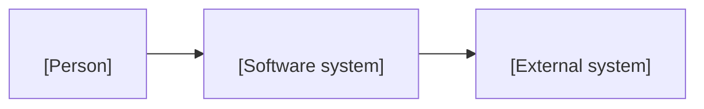

# <Repo or app> context

<!-- CONTEXT.md template on the arc42 canvas (new-project playbook, phase 2 Architecture). It sits at the repo root and
is the first file an engineer or an agent reads before changing the repo. Size cap: about 60 KB; past that, move a
module's detail into docs/modules/<module>.md and link it here (CIS grew to about 530 KB, which no one can learn in
order). Diagrams as code (Mermaid, C4 labels, at most 15 nodes). Fill sections 1 to 6 on day 1; the rest as the code
grows. Delete this comment. -->

## 1. Goal and stakeholders

<What the product does, for whom, and the one success metric from the charter. Link the charter.>

## 2. Constraints

<Fixed choices: cloud, region, language, licences, regulation, budget, team shape.>

## 3. Context (C4 level 1)

## 4. Solution strategy

<Three to six bullets: the main technology choices and the ADR behind each.>

## 5. Containers (C4 level 2)

| Container | Technology | Owns (data, jobs, routes) | Talks to |
|---|---|---|---|
| api | <FastAPI> | <schema, job kinds> | <db, queue> |
| web | <Next.js> | <pages> | <api> |
| worker | <...> | <job kinds> | <db> |

## 6. Boundaries and contracts

- **Data this repo writes (one writer per entity):** <schema and tables>.
- **Data it reads from others, and through which contract:** <contract name and version>.
- **Contracts it publishes:** <name, version, consumers>.

## 7. Runtime views

<The two or three flows that matter most, as short numbered steps or one sequence diagram each.>

## 8. Deployment

<Environments, how a change reaches each, the health URL, the rollback command. Names, not resource IDs.>

## 9. Cross-cutting concepts

<Auth, tenancy, settings registry, job table, logging, error shape, feature flags, AI gateway if used.>

## 10. Decisions

| ADR | Decision | Status |
|---|---|---|
| <nnnn> | <...> | <Accepted> |

## 11. Quality requirements

Use the nine ISO/IEC 25010:2023 names: functional suitability, performance efficiency, compatibility, interaction
capability, reliability, security, maintainability, flexibility, safety.

| Quality | Scenario and target | Checked by |
|---|---|---|
| <reliability> | <...> | <alarm, test> |

## 12. Risks and technical debt

Link the RAID log; list here only the technical items with their owner.

## 13. Run it locally

1. <Prerequisites and versions.>
2. <Install command.>
3. <Start command and the URL that proves it runs.>
4. <Test command.>

## 14. Glossary

| Term | Meaning here |
|---|---|
| <term> | <...> |
