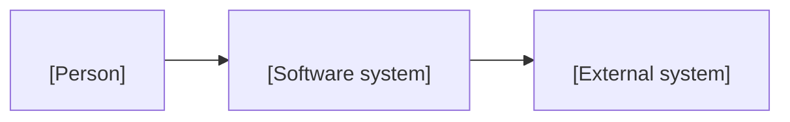

# Bối cảnh <repo hoặc app>

<!-- Mẫu CONTEXT.md trên canvas arc42 (playbook dự án mới, pha 2 Kiến trúc). Nó nằm ở gốc repo và là file đầu tiên một
kỹ sư hay một agent đọc trước khi sửa repo. Trần dung lượng: khoảng 60 KB; quá mức đó, chuyển chi tiết của một module
sang docs/modules/<module>.md và trỏ tới từ đây (CIS đã phình tới khoảng 530 KB, không ai học theo thứ tự được). Sơ đồ
dạng code (Mermaid, nhãn C4, tối đa 15 nút). Điền mục 1 tới 6 ngay ngày đầu; phần còn lại theo code lớn dần. Xoá ghi chú
này. -->

## 1. Mục tiêu và các bên liên quan

<Sản phẩm làm gì, cho ai, và một chỉ số thành công lấy từ điều lệ. Trỏ tới điều lệ.>

## 2. Ràng buộc

<Các lựa chọn cố định: cloud, region, ngôn ngữ, giấy phép, quy định, ngân sách, hình dạng đội.>

## 3. Bối cảnh (C4 mức 1)

## 4. Chiến lược giải pháp

<Ba tới sáu gạch đầu dòng: các lựa chọn công nghệ chính và ADR đứng sau mỗi lựa chọn.>

## 5. Container (C4 mức 2)

| Container | Công nghệ | Sở hữu (dữ liệu, job, route) | Nói chuyện với |
|---|---|---|---|
| api | <FastAPI> | <schema, loại job> | <db, hàng đợi> |
| web | <Next.js> | <các trang> | <api> |
| worker | <...> | <loại job> | <db> |

## 6. Ranh giới và hợp đồng

- **Dữ liệu repo này ghi (mỗi thực thể một bên ghi):** <schema và bảng>.
- **Dữ liệu nó đọc từ bên khác, và qua hợp đồng nào:** <tên và phiên bản hợp đồng>.
- **Hợp đồng nó công bố:** <tên, phiên bản, bên dùng>.

## 7. View lúc chạy

<Hai hoặc ba luồng quan trọng nhất, mỗi luồng là các bước đánh số ngắn hoặc một sơ đồ tuần tự.>

## 8. Deploy

<Các môi trường, một thay đổi tới từng môi trường thế nào, URL health, lệnh rollback. Dùng tên, không dùng resource ID.>

## 9. Khái niệm xuyên suốt

<Xác thực, tenancy, registry settings, bảng job, log, hình dạng lỗi, feature flag, AI gateway nếu dùng.>

## 10. Quyết định

| ADR | Quyết định | Trạng thái |
|---|---|---|
| <nnnn> | <...> | <Accepted> |

## 11. Yêu cầu chất lượng

Dùng chín tên của ISO/IEC 25010:2023: functional suitability, performance efficiency, compatibility, interaction
capability, reliability, security, maintainability, flexibility, safety.

| Chất lượng | Kịch bản và mục tiêu | Kiểm bằng |
|---|---|---|
| <reliability> | <...> | <alarm, test> |

## 12. Rủi ro và nợ kỹ thuật

Trỏ tới sổ RAID; ở đây chỉ liệt kê các mục kỹ thuật kèm người phụ trách.

## 13. Chạy local

1. <Điều kiện cần và phiên bản.>
2. <Lệnh cài đặt.>
3. <Lệnh khởi động và URL chứng minh nó chạy.>
4. <Lệnh test.>

## 14. Thuật ngữ

| Thuật ngữ | Nghĩa ở đây |
|---|---|
| <thuật ngữ> | <...> |
