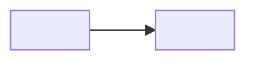

# <Noun>

## Context

<The problem this part of the system solves. Three to five sentences.>

## How it works

<Three to six paragraphs that walk the diagram.>

## Why it is built this way

<Trade-offs. Link the ADRs; do not copy decision text.>

## Boundaries

- Owns: <what>.
- Does not own: <what, and who does>.

## Limits and gotchas

- <Known limit, with the number and where it is enforced.>

## Open questions

- <Question - who decides - issue>.
