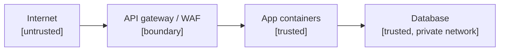

# Threat model - <system>

<!-- Light threat model (new-project playbook, phase 2 Architecture, gate G2). STRIDE per container: spoofing,
tampering, repudiation, information disclosure, denial of service, elevation of privilege. One table row per real
threat, not per letter. Re-run when a container, a trust boundary or a data class is added. A security finding about a
public repo is written in a private place. Delete this comment. -->

## 1. Assets

| Asset | Data class | Where it lives | Owner |
|---|---|---|---|
| <customer contact data> | <personal> | <schema.table> | <role> |
| <payment references> | <financial> | <...> | <...> |
| <secrets and keys> | <secret> | <secret store> | <...> |

## 2. Trust boundaries

## 3. Threats per container

| Container | STRIDE | Threat | Control in place | Gap and tracker link | Level (ASVS area) |
|---|---|---|---|---|---|
| api | S | <stolen session token reused> | <short-lived tokens, rotation> | <...> | <L2: auth> |
| api | I | <tenant A reads tenant B rows> | <row-level security with FORCE, isolation probe> | <...> | <L2> |
| web | T | <cross-site write> | <same-site cookies, origin check> | <...> | <L1> |
| worker | D | <a job floods a provider> | <spend caps, rate limits as settings> | <...> | <L1> |

## 4. Abuse cases

<Two to five short stories of how a real attacker or a careless insider would misuse the product, and what stops them.>

## 5. Decisions

- Security level per area: ASVS 5.0 level 1 everywhere; level 2 for authentication, payment and personal data.
- <Accepted risks, with the role that accepted them and the review date.>
