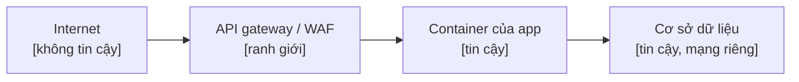

# Mô hình mối đe doạ - <hệ thống>

<!-- Mô hình mối đe doạ gọn (playbook dự án mới, pha 2 Kiến trúc, cổng G2). STRIDE theo từng container: spoofing,
tampering, repudiation, information disclosure, denial of service, elevation of privilege. Mỗi mối đe doạ thật một
dòng, không phải mỗi chữ cái một dòng. Chạy lại khi thêm một container, một ranh giới tin cậy hay một loại dữ liệu. Một
phát hiện bảo mật về repo public thì viết ở nơi riêng tư. Xoá ghi chú này. -->

## 1. Tài sản

| Tài sản | Loại dữ liệu | Nằm ở đâu | Người phụ trách |
|---|---|---|---|
| <dữ liệu liên hệ của khách> | <cá nhân> | <schema.table> | <vai trò> |
| <tham chiếu thanh toán> | <tài chính> | <...> | <...> |
| <secret và khoá> | <secret> | <kho secret> | <...> |

## 2. Ranh giới tin cậy

## 3. Mối đe doạ theo container

| Container | STRIDE | Mối đe doạ | Biện pháp đang có | Khoảng trống và link công cụ theo dõi việc | Mức (vùng ASVS) |
|---|---|---|---|---|---|
| api | S | <token phiên bị đánh cắp rồi dùng lại> | <token sống ngắn, xoay vòng> | <...> | <L2: xác thực> |
| api | I | <tenant A đọc được dòng của tenant B> | <row-level security có FORCE, probe cách ly> | <...> | <L2> |
| web | T | <ghi chéo site> | <cookie same-site, kiểm origin> | <...> | <L1> |
| worker | D | <một job dội quá tải nhà cung cấp> | <trần chi tiêu, giới hạn tần suất dạng settings> | <...> | <L1> |

## 4. Kịch bản lạm dụng

<Hai tới năm câu chuyện ngắn về cách một kẻ tấn công thật hay một người trong nội bộ bất cẩn có thể lạm dụng sản phẩm, và
cái gì chặn họ.>

## 5. Quyết định

- Mức bảo mật theo vùng: ASVS 5.0 mức 1 ở mọi nơi; mức 2 cho xác thực, thanh toán và dữ liệu cá nhân.
- <Các rủi ro được chấp nhận, kèm vai trò đã chấp nhận và ngày rà soát.>
